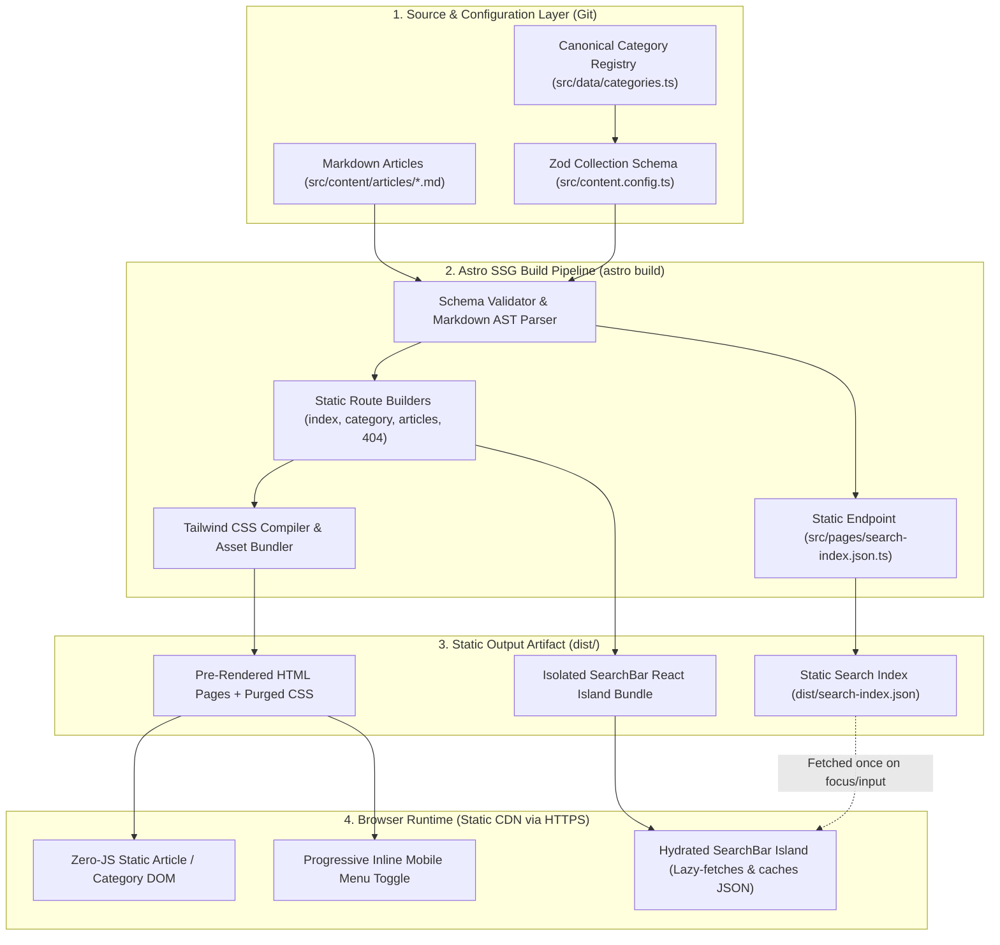
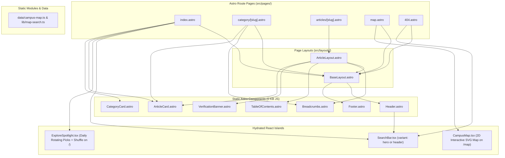

# Software Architecture Document: Geary — Unofficial BulSU Student Information Hub

---

## 1. Document Control & Architectural Scope

| Attribute | Details |
| :--- | :--- |
| **Document Title** | Software Architecture Document: Geary — Unofficial BulSU Student Information Hub |
| **Version** | `1.0 (MVP Baseline)` |
| **Date** | `2026-11-17` |
| **Standard Reference** | ISO/IEC/IEEE 42010 (*Architecture description*) & ISO/IEC/IEEE 12207 Clause 6.4.3 (*Architecture Definition Process*) |
| **Related Baselines** | [PROJECT_CHARTER.md](./PROJECT_CHARTER.md), [PRD.md](./PRD.md), [SRS.md](./SRS.md), [DESIGN_SYSTEM.md](./DESIGN_SYSTEM.md) |
| **Status** | Approved for Repository Scaffolding |

This document defines the technical stack, build-time vs. runtime architecture, Astro Islands hydration boundaries, component responsibilities, module contracts, and repository directory structure realizing Geary's MVP baseline.

---

## 2. Technology Stack

| Layer | Technology | Role in Geary | Architectural Rationale |
| :--- | :--- | :--- | :--- |
| **Runtime, Package Manager & Test Runner** | **Bun** (`bun.lock`, `bun test`) | Manages dependencies, executes `astro` CLI scripts, and runs pure TypeScript unit tests. | Single ultra-fast runtime and built-in test runner with deterministic lockfile management. |
| **Static Site Generator / Meta-Framework** | **Astro (`^7.4.12`)** (`output: 'static'`) | Compiles layouts, Content Collections, static routes, and JSON endpoints at build time. | Ships zero framework JavaScript by default for static content routes, maximizing mobile load speed and static CDN scalability. |
| **Styling & Design System** | **Tailwind CSS (`@tailwindcss/vite`)** | Generates utility styles, design tokens, and scoped prose typography via Vite plugin. | Produces minimal purged CSS bundles bound to [DESIGN_SYSTEM.md](./DESIGN_SYSTEM.md) tokens without runtime style overhead. |
| **Interactive UI Islands** | **React** (`@astrojs/react`) | Hydrates `<SearchBar />` via `client:load` for stateful client-side search. | Isolates React runtime cost strictly to the search island instead of hydrating static article pages. |
| **Content & Schema Layer** | **Astro Content Collections + Markdown (`.md`) + TypeScript + Zod** | Parses Git-tracked guides and enforces frontmatter types at compile time. | Eliminates external CMS/database dependencies while catching schema errors during build. |
| **Search Index & Scorer** | **Static JSON Endpoint (`search-index.json.ts`) + TypeScript Scorer** | Emits pre-built index at build time and evaluates queries synchronously in `SearchBar.tsx`. | Requires zero external search SaaS and executes client-side filtering synchronously with no backend hops. |
| **Deployment Artifact** | **Vendor-Neutral Static `dist/`** | Self-contained HTML/CSS/JS/JSON assets deployable to Cloudflare Pages, Vercel, Netlify, or GitHub Pages. | Avoids server runtime adapters and hosting lock-in. |

---

## 3. High-Level System & Islands Architecture

### 3.1 Build-Time vs. Runtime Pipeline

Geary separates **build-time static compilation** from **runtime static delivery**:



### 3.2 Astro Islands Hydration Boundary
- **Zero-JS Static Components:** `BaseLayout.astro`, `ArticleLayout.astro`, `Header.astro`, `Footer.astro`, `Breadcrumbs.astro`, `CategoryCard.astro`, `ArticleCard.astro`, `TableOfContents.astro`, and `VerificationBanner.astro` compile strictly to static HTML and CSS.
- **Selective React Hydration (`client:load` / `client:idle`):** `SearchBar.tsx` (`client:load`) registers global keyboard shortcuts (`/`, `Ctrl+K` / `Cmd+K`) immediately on load, `CampusMap.tsx` (`client:load` on `/map`) drives interactive SVG pan/zoom/search, and `ExploreSpotlight.tsx` (`client:load` on `/`) renders 6 Featured guides cycling through 3 daily randomized groups seeded by local calendar date.
- **Minimal Progressive Enhancement (`< 1 KB`):** Mobile navigation drawer state inside `Header.astro` uses a tiny inline vanilla script, and mobile Table of Contents disclosure uses native HTML `<details>`/`<summary>`.

### 3.3 Content-to-Build Propagation
Adding or editing one `.md` file in `src/content/articles/` updates four build outputs simultaneously:
1. **Article View (`/articles/[slug]`):** Renders compiled Markdown prose, extracts `h2`/`h3` headings for TOC navigation, builds breadcrumbs, and resolves up to 3 sibling guides in the same category.
2. **Category Directory (`/categories/[slug]`):** Updates guide counts and places the article card under its `subcategory` heading.
3. **Home Directory (`/`):** Includes the article in the daily randomized 3×6 **Featured** pool.
4. **Search Payload (`/search-index.json`):** Serializes the article's `slug`, `title`, `preview` (derived from Markdown body), `category`, `categoryLabel`, `subcategory`, and `headings` array.

---

## 4. Component Architecture & Responsibilities

### 4.1 Component Composition Hierarchy



### 4.2 Module & Component Responsibilities

| Component / Module | Type & Hydration | Props / Inputs | Structural Responsibilities |
| :--- | :--- | :--- | :--- |
| **`src/layouts/BaseLayout.astro`** | Astro Layout (`0 KB` JS) | `title`, `description?`, `activeCategory?`, `activeNav?`, `headerSearchShortcut?`, `ogType?`, `ogImageAlt?`, `articleMeta?`, `noindex?`, `jsonLd?` | Renders `<html lang="en">`, document metadata, canonical `<link>`, Open Graph (`og:*`, `article:*`), Twitter cards (`twitter:image:alt`), optional JSON-LD `<script>`, robots meta, global CSS import, skip-to-content link, `<Header />`, `<main>`, and `<Footer />`. |
| **`src/layouts/ArticleLayout.astro`** | Astro Layout (`0 KB` JS) | `article`, `categoryMeta`, `headings`, `relatedArticles` | Composes `BaseLayout`, `<Breadcrumbs />`, article metadata header, responsive grid pairing Markdown prose with `<TableOfContents />`, `<VerificationBanner />`, and up to 3 sibling `<ArticleCard />` items. |
| **`src/components/Header.astro`** | Static Astro + `< 1 KB` toggle | `activeCategory?: CategorySlug`, `showSearch?: boolean` | Renders brand logo (`/`), category navigation links, compact `<SearchBar variant="header" client:load />`, and accessible mobile menu drawer toggle. |
| **`src/components/Footer.astro`** | Static Astro (`0 KB` JS) | Imports `CATEGORIES` | Renders global unofficial BulSU student hub disclaimer and category directory links. |
| **`src/components/Breadcrumbs.astro`** | Static Astro (`0 KB` JS) | `items: Array<{ label: string; href?: string }>` | Renders semantic breadcrumb trail linking parent routes and marking the current page. |
| **`src/components/CategoryCard.astro`** | Static Astro (`0 KB` JS) | `category: CategoryMeta`, `count: number`, `previewArticles: ArticleEntry[]` | Renders category summary card with icon, guide count, up to 3 preview links, and `"Explore all →"` route link. |
| **`src/components/ArticleCard.astro`** | Static Astro (`0 KB` JS) | `article: ArticleEntry`, `categoryMeta?: CategoryMeta`, `showCategoryBadge?: boolean` | Renders scannable article link card with title and 2-line body preview. |
| **`src/components/TableOfContents.astro`** | Static Astro (`0 KB` JS) | `headings: MarkdownHeading[]`, `mode: 'desktop' \| 'mobile'` | Filters `depth === 2 \|\| depth === 3`; renders nothing when `< 2` headings exist; outputs sticky sidebar (`desktop`) or `<details>` disclosure (`mobile`). |
| **`src/components/VerificationBanner.astro`** | Static Astro (`0 KB` JS) | `updatedDate: Date` | Displays official office verification notice and `updatedDate` at the bottom of articles. |
| **`src/components/SearchBar.tsx`** | **React Island (`client:load`)** | `variant: 'hero' \| 'header'`, `enableGlobalShortcut?: boolean` | Lazily fetches & caches `/search-index.json` in module memory; executes pure weighted literal substring scorer (`src/lib/search.ts`); manages keyboard navigation, outside-click dismissal, zero-match pills, and fetch-error fallback UI. |
| **`src/lib/search.ts`** | Pure TypeScript Module | `items: SearchIndexItem[]`, `query: string` | Implements query normalization and weighted multi-term scoring (`title` > `headings`/`subcategory` > `preview`/`categoryLabel`), cleanly unit-testable in isolation from React DOM. |
| **`src/lib/articles.ts`** | Pure TypeScript Module | `articles: ArticleEntry[]` | Implements deterministic subcategory grouping (`groupArticlesBySubcategory`) and related-guide selection helpers shared by page templates and unit tests. |

---

## 5. Integrations & Module Contracts

### 5.1 Framework Integrations (`astro.config.mjs`)
- **`site` configuration:** Configured from `process.env.PUBLIC_SITE_URL`, falling back to Vercel production/deployment URLs (`VERCEL_PROJECT_PRODUCTION_URL` / `VERCEL_URL`) and locally `https://geary.example.com`, so canonical URLs, Open Graph URLs, `robots.txt`, and sitemaps resolve consistently across environments.
- **`@astrojs/react`:** Enables selective client hydration of `SearchBar.tsx` inside `.astro` files.
- **`@astrojs/sitemap`:** Generates `dist/sitemap-index.xml` at build time, excluding `/404` and non-HTML utility routes.
- **Tailwind CSS (`@tailwindcss/vite`):** Compiles utility classes and `src/styles/global.css` tokens through Astro's Vite plugin pipeline.
- **`output: 'static'` & `build.inlineStylesheets: 'always'`:** Pure SSG output targeting `dist/` with inlined CSS to eliminate render-blocking stylesheet requests.

### 5.2 TypeScript Data Contracts

#### `src/data/categories.ts`
Single source of truth imported by Content Collection schemas, pages, navigation components, and `search-index.json.ts`:

```ts
export const CATEGORY_SLUGS = [
  'enrollment',
  'academics',
  'documents',
  'scholarships',
  'policies',
  'organizations',
  'campus',
] as const;

export type CategorySlug = (typeof CATEGORY_SLUGS)[number];

export interface CategoryMeta {
  slug: CategorySlug;
  title: string;
  description: string;
  icon: string;
  order: number;
}
```

#### `src/content.config.ts` (Astro Content Collection Schema)
Defines the `articles` collection using Astro's Content Layer `glob` loader and Zod validation against `CATEGORY_SLUGS`:

```ts
import { defineCollection } from 'astro:content';
import { glob } from 'astro/loaders';
import { z } from 'astro/zod';
import { CATEGORY_SLUGS } from './data/categories';

export const articleSchema = z.object({
  title: z.string().min(1),
  category: z.enum(CATEGORY_SLUGS),
  subcategory: z.string().min(1),
  updatedDate: z.coerce.date(),
  source: z.string().min(1).optional(),
  sourceUrl: z.url().optional(),
});

export const collections = {
  articles: defineCollection({
    loader: glob({ pattern: '**/*.md', base: './src/content/articles' }),
    schema: articleSchema,
  }),
};
```

#### `src/pages/search-index.json.ts`
Build-time `GET` endpoint exporting static JSON conforming to `SearchIndexItem[]`:

```ts
export interface SearchIndexItem {
  slug: string;
  title: string;
  preview: string;
  category: CategorySlug;
  categoryLabel: string;
  subcategory: string;
  headings: string[];
}
```

### 5.3 External Runtime Integrations
Geary has no external runtime dependency for its core information hub: there are no databases, hosted search SaaS, LLM APIs, authentication services, or third-party tracking scripts. The existing `/contribute` page embeds a Google Form as an optional third-party submission surface; it is a documented governance exception that requires a dedicated scope decision before further expansion.

---

## 6. Project Directory Structure

```text
geary/
├── PROJECT_CHARTER.md               # ISO 12207 Project Charter
├── PRD.md                           # Adapted ISO 29148 Product Requirements Document
├── SRS.md                           # ISO 29148 / 25010 Software Requirements Specification
├── USER_FLOWS.md                    # ISO 29148 Operational Concept & User Flows
├── ARCHITECTURE.md                  # This Software Architecture Document
├── TESTING.md                       # ISO 25010 / 29148 Lean Verification & Testing Spec
├── DESIGN_SYSTEM.md                 # ISO 25010 / WCAG 2.1 Design System Specification
├── REQUIREMENTS.md                  # ISO 29148 Master Requirements Traceability Matrix (RTM)
├── ROADMAP.md                       # ISO 12207 Project Milestones, Backlog & Known Issues
├── AGENTS.md                        # Repository agent development instructions
├── WRITING_FRAMEWORK.md             # Editorial, tone & humanizer writing standard
├── README.md                        # Contributor quickstart, commands & spec index
├── package.json                     # Project dependencies & scripts (dev, check, build, test)
├── bun.lock                         # Bun deterministic dependency lockfile
├── bunfig.toml                      # Scopes `bun test` strictly to tests/unit/
├── playwright.config.ts             # Playwright E2E/Axe config (webServer -> astro preview)
├── astro.config.mjs                 # Astro static config + @astrojs/react + @tailwindcss/vite
├── tsconfig.json                    # Strict TypeScript compiler configuration
├── public/                          # Static assets copied verbatim to dist/
│   ├── apple-touch-icon.png         # 180x180 Geary touch icon for iOS / Android
│   ├── favicon-48x48.png            # 48x48 PNG favicon for Google Search & mobile
│   ├── favicon-96x96.png            # 96x96 high-DPI PNG favicon
│   ├── favicon.ico                  # Multi-size (16/32/48px) Geary fallback favicon
│   ├── favicon.svg                  # Minimalist Geary geometric gear icon
│   ├── googled56ea9e672e7afb1.html  # Google Search Console ownership verification
│   └── og-image.png                 # Shared 1200x630 Open Graph social preview card
├── tests/                           # Lean unit & Playwright E2E/Axe smoke tests
│   ├── unit/
│   │   ├── search.test.ts           # Bun test suite for query scoring & index contract
│   │   ├── articles.test.ts         # Bun test suite for subcategory grouping helpers
│   │   └── seo.test.ts              # Bun test suite for JSON-LD builders & XSS escape
│   └── e2e/
│       └── smoke.spec.ts            # Playwright + Axe smoke, SEO, TOC, overflow & 404 tests
└── src/
    ├── styles/
    │   └── global.css               # Tailwind import, design tokens, scoped prose styles
    ├── data/
    │   └── categories.ts            # Canonical 7-category registry & lookup helpers
    ├── lib/
    │   ├── search.ts                # Pure query normalization & weighted scoring engine
    │   ├── articles.ts              # Subcategory grouping & sibling guide helpers
    │   └── seo.ts                   # Pure JSON-LD builders (WebSite, Article, BreadcrumbList)
    ├── content.config.ts            # Astro Content Collection + Zod schema (`articles`)
    ├── content/
    │   └── articles/                # 30 UTF-8 handbook-verified Markdown guides
    ├── layouts/
    │   ├── BaseLayout.astro         # Global HTML shell, Header & Footer
    │   └── ArticleLayout.astro      # Constrained prose reading layout, TOC & related
    ├── components/
    │   ├── Header.astro             # Global navbar, gear logo, mobile menu, Header SearchBar
    │   ├── Footer.astro             # Unofficial disclaimer & category directory links
    │   ├── Breadcrumbs.astro        # Hierarchical Home > Category > Article navigation
    │   ├── CategoryCard.astro       # Home directory card with count & preview links
    │   ├── ArticleCard.astro        # Scannable article summary card
    │   ├── TableOfContents.astro    # Conditional h2/h3 TOC (sticky desktop / <details> mobile)
    │   ├── VerificationBanner.astro # Official office verification notice
    │   └── SearchBar.tsx            # Hydrated React island consuming /search-index.json
    └── pages/
        ├── index.astro              # Home hub (Hero SearchBar, Featured Guides)
        ├── map.astro                # Interactive 2D BulSU Malolos Campus Map island
        ├── contribute.astro         # Community submission page with embedded Google Form
        ├── terms.astro              # Terms of Service & unofficial disclaimer page
        ├── privacy.astro            # Privacy Policy (zero-tracking static architecture)
        ├── 404.astro                # Branded recovery page with SearchBar & categories (`noindex`)
        ├── robots.txt.ts            # Build-time generator referencing Astro.site sitemap
        ├── search-index.json.ts     # Build-time generator for /search-index.json
        ├── categories/
        │   ├── index.astro          # Categories directory page (7 CategoryCards)
        │   └── [slug].astro         # Subcategory-grouped category directory pages
        └── articles/
            └── [slug].astro         # Individual Markdown guide pages
```
