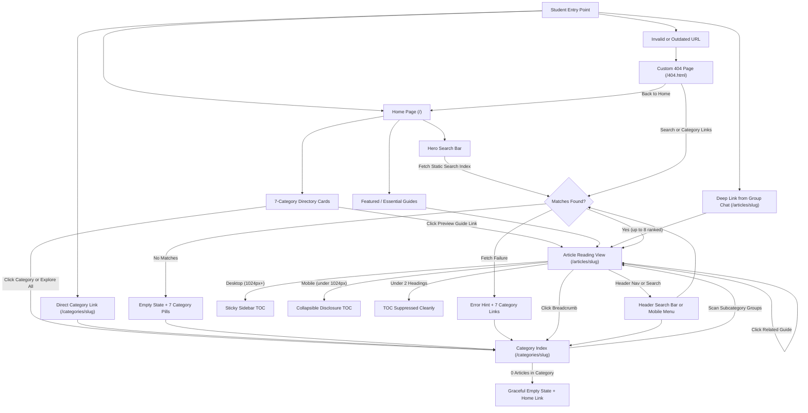
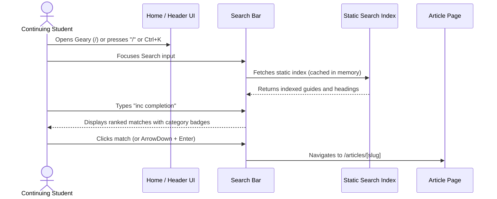

# User Flows & Operational Scenarios: Geary — Unofficial BulSU Student Information Hub

---

## 1. Document Control & Operational Context *(ISO 29148 Clauses 9.3.1, 9.3.2 & 9.3.4)*

### 1.1 Document Identification

| Attribute | Details |
| :--- | :--- |
| **Document Title** | User Flows & Operational Scenarios: Geary — Unofficial BulSU Student Information Hub |
| **Version** | `1.0 (MVP Baseline)` |
| **Date** | `2026-11-17` |
| **Standard Reference** | Adapted from ISO/IEC/IEEE 29148:2018 — *Systems and software engineering — Life cycle processes — Requirements engineering* (Clause 9.3 *Operational Concept [OpsCon]*, Clause 9.3.4 *Operational Modes*, Clause 9.3.5 *Operational Scenarios*, & Clauses 6.2/6.3 *Use-Case Modeling*) |
| **Related Baselines** | [PROJECT_CHARTER.md](./PROJECT_CHARTER.md), [PRD.md](./PRD.md), [SRS.md](./SRS.md) |
| **Status** | Approved for Implementation & UX Verification |

### 1.2 Purpose & Actor Reference
This document defines Geary's **Operational Modes**, **Master Navigation Flow**, **Operational Scenarios (`UJ-*`)**, **Use Cases (`UC-*`)**, **Alternative Flows (`AF-*`)**, and **Off-Nominal / Error Scenarios (`ERR-*`)**, including campus-map discovery.

User classes referenced throughout these flows are defined in [PROJECT_CHARTER.md](./PROJECT_CHARTER.md) Section 5:
- `ACT-01`: Incoming Freshman
- `ACT-02`: Shiftee / Transferee
- `ACT-03`: Continuing Undergraduate
- `ACT-04`: Student Maintainer / Contributor

### 1.3 Operational Modes (`MODE-01` to `MODE-04`) *(ISO 29148 Clause 9.3.4)*

| Mode ID | Operational Mode | Activation Condition | Operational Behavior |
| :--- | :--- | :--- | :--- |
| **MODE-01** | **Nominal Static Browsing & Reading** | Student visits `/`, `/categories/[slug]`, or `/articles/[slug]`. | Instant static HTML browsing, hierarchical category skimming, and distraction-free article reading with native TOC/menu controls. |
| **MODE-02** | **Interactive Client Search** | Student focuses the Search Bar or triggers `/` or `Ctrl+K` (`Cmd+K`). | Client-side search loads and caches the static search index, ranks multi-term queries, and supports full keyboard result selection. |
| **MODE-03** | **Degraded / Off-Nominal Recovery** | Search yields zero results, index fetch fails on unstable mobile data, or student opens a broken URL. | System surfaces calm recovery cues—category quick-jump links, retry guidance, or the branded `404` page. |
| **MODE-04** | **Build-Time Content Authoring & Validation** | Maintainer adds or edits a Markdown article and compiles the site. | Automated build checks validate frontmatter metadata, regenerate static pages, and update the search index. |

---

## 2. Master Navigation & State Transition Diagram *(ISO 29148 Clause 9.3.4)*

---

## 3. Operational Scenarios / End-to-End User Journeys (`UJ-01` to `UJ-06`) *(ISO 29148 Clause 9.3.5)*

### `UJ-01`: Urgent Search-First Lookup (Checking `INC` or `TOR`)
- **Actor:** `ACT-03` (Continuing Undergraduate on mobile between classes)
- **Trigger:** Student urgently needs the deadline and office window for completing an `INC` grade or requesting a `TOR`.
- **Operational Mode:** `MODE-01` → `MODE-02` → `MODE-01`
- **Journey Steps:**
  1. Student opens `/` on mobile; the prominent Hero Search Bar sits above the fold.
  2. Student taps the input; the search bar lazily fetches and caches the static index once.
  3. Student types `"inc completion"` (or `"tor"`).
  4. Top matching result displays with its *Registrar & Documents* category badge and summary.
  5. Student taps the result and lands directly on the target guide to view step-by-step instructions.
- **Expected Outcome:** Student locates the required office procedure in seconds with zero backend latency.

---

### `UJ-02`: Category & Subcategory Exploration (Enrollment or Campus Spots)
- **Actor:** `ACT-01` (Incoming Freshman) or `ACT-02` (Shiftee / Transferee)
- **Trigger:** Student does not know exact university terminology yet and wants to browse enrollment steps or affordable food spots.
- **Operational Mode:** `MODE-01`
- **Journey Steps:**
  1. Student opens `/` and scrolls past search to the **7-Category Directory**.
  2. Student reviews category descriptions, guide counts, and top preview links.
  3. Student opens *Enrollment* (`/categories/enrollment`).
  4. Guides appear neatly grouped under purposeful `subcategory` headings (e.g., *Freshmen*, *Shifting & Transferring*, *Returning / LOA*).
  5. Student skims the 1-sentence summaries and opens *How to Shift Programs at BulSU*.
- **Expected Outcome:** Student discovers needed procedures through predictable hierarchy without memorizing university jargon.

---

### `UJ-03`: Mobile Deep-Link Skimming from a Group Chat (`375px` Viewport)
- **Actor:** `ACT-03` (Continuing Undergraduate)
- **Trigger:** A classmate shares a direct article link (e.g., `/articles/latin-honors-and-gwa`) in a group chat; student wants only the GWA table.
- **Operational Mode:** `MODE-01`
- **Journey Steps:**
  1. Student opens the link directly on a narrow `375px` phone screen.
  2. At the top, breadcrumbs (`Home › Handbook & Policies › Latin Honors & GWA`), category badge, title, and *Last Updated* timestamp establish immediate context.
  3. Directly beneath the header sits the collapsed `"On this page"` disclosure panel.
  4. Student expands it, taps `"GWA Bracket Requirements"`, and jumps straight to the section.
  5. Student swipes horizontally across the contained comparison table without causing page-wide horizontal scrolling.
  6. At the end, a verification reminder advises confirming official rules with the Registrar, followed by up to 3 sibling *Related Guides in This Category*.
- **Expected Outcome:** Mobile reader reaches the exact table cleanly with low cognitive load and zero layout overflow.

---

### `UJ-04`: Cross-Category Pivot via Breadcrumbs & Header Navigation
- **Actor:** `ACT-01` or `ACT-02`
- **Trigger:** After finishing an enrollment guide, the student wants to explore scholarships or campus food spots.
- **Operational Mode:** `MODE-01` ↔ `MODE-02`
- **Journey Steps:**
  1. From any article page, student opens the mobile Header menu (or clicks a desktop top nav link) — or triggers Header search via `/` or `Ctrl+K`.
  2. Student navigates directly to *Scholarships* (`/categories/scholarships`), or steps back up to the parent category via breadcrumbs.
- **Expected Outcome:** Effortless cross-topic exploration from any depth of the site.

---

### `UJ-05`: Markdown Content Authoring & Validation (Maintainer Flow)
- **Actor:** `ACT-04` (Student Maintainer)
- **Trigger:** Maintainer publishes or updates a guide for the current Academic Year.
- **Operational Mode:** `MODE-04`
- **Journey Steps:**
  1. Maintainer creates or edits a Markdown article file with required frontmatter metadata and structured prose.
  2. Maintainer runs the static build command.
  3. Build validation confirms metadata accuracy and regenerates static pages and the search index.
  4. Maintainer pushes updates via Git for zero-cost static deployment.
- **Expected Outcome:** Updated content goes live with schema integrity guaranteed before deployment.

---

### `UJ-06`: Find a Campus Office or Facility
- **Actor:** `ACT-01`, `ACT-02`, or `ACT-03`
- **Trigger:** Student needs to find an office or campus facility, such as the Registrar, Clinic, Library, or Canteen.
- **Operational Mode:** `MODE-02`
- **Journey Steps:**
  1. Student opens `/map` from the Header or a direct link.
  2. Student searches for an office/facility or selects a building footprint.
  3. The map identifies the parent building, focuses the SVG view, and highlights that building.
  4. The inspector lists the building name and the locations it contains.
- **Expected Outcome:** Student identifies the correct building and its relevant office without external map tiles or a backend request.

---

## 4. Use Cases, Alternative Flows & Exception Scenarios (`UC-01` to `UC-05`) *(ISO 29148 Clauses 6.2.1.3 & 9.5.3)*

---

### `UC-01`: Search for a Guide

| Field | Details |
| :--- | :--- |
| **Actors** | `ACT-01`, `ACT-02`, `ACT-03` |
| **Operational Modes** | `MODE-02` (Nominal), `MODE-03` (Zero-match / fetch-error fallback) |
| **Preconditions** | Site built with valid static search index; client browser supports JavaScript. |
| **Postconditions** | Student opens a target article (`/articles/[slug]`) or navigates to a fallback category page. |

#### Main Success Scenario (Basic Flow)
1. Student focuses the Hero or Header Search Bar.
2. Client loads and caches the static search index once in memory.
3. Student types a single- or multi-word query (e.g., `"latin honors"`).
4. Results list displays up to `8` ranked matches showing title, category badge, subcategory, and summary.
5. Student selects a result; browser opens `/articles/[slug]` and closes the overlay.

#### Alternative Flows
- **`AF-01A` (Keyboard-Only Navigation):** Student presses `/` or `Ctrl+K` (`Cmd+K`) outside text inputs to focus search; uses `ArrowDown` / `ArrowUp` to move highlight; presses `Enter` to open the highlighted guide; presses `Escape` to dismiss.
- **`AF-01B` (Header Search from Sub-Pages):** On Category, Article, or 404 routes, student invokes the compact Header Search Bar with identical ranking and keyboard support.
- **`AF-01C` (Overlay Dismissal):** Tapping outside the search container or clearing the input closes the dropdown cleanly.

#### Exception / Off-Nominal Scenarios
- **`EF-01A` (Zero Matches):** Non-empty query matches `0` articles → dropdown displays a calm no-results message alongside 7 clickable category quick-jump pills.
- **`EF-01B` (Index Fetch Failure):** Unstable mobile connection blocks loading the index → search catches the error safely, shows a retry hint, and provides direct links to all 7 categories.
- **`EF-01C` (Whitespace or Special Punctuation):** Whitespace-only input keeps results closed; special characters (e.g., `"[INC] (2026)*?"`) are evaluated safely as plain text without throwing errors.

---

### `UC-02`: Browse Categories & Subcategories

| Field | Details |
| :--- | :--- |
| **Actors** | `ACT-01`, `ACT-02`, `ACT-03` |
| **Operational Modes** | `MODE-01` (Nominal), `MODE-03` (Empty category fallback) |
| **Preconditions** | All seven canonical category pages are compiled. |
| **Postconditions** | Student navigates to a topic-grouped guide. |

#### Main Success Scenario (Basic Flow)
1. Student inspects the **7-Category Directory** on `/`.
2. Student selects a category card (or `"Explore all →"`) to open `/categories/[slug]`.
3. Page displays breadcrumbs (`Home › [Category Name]`) and guides grouped under `subcategory` headers.
4. Student skims guide cards (`title`, summary, *Last Updated* date) and opens an article.

#### Alternative Flows
- **`AF-02A` (Preview Quick-Link):** Student clicks one of the top-3 preview links directly inside a Home category card to open `/articles/[slug]` in one click.
- **`AF-02B` (Featured Guides):** Student selects a high-frequency guide directly from the Home **Featured / Essential Guides** section.
- **`AF-02C` (Header / Mobile Drawer Switch):** Student jumps directly between categories via the desktop top navigation or mobile hamburger drawer.

#### Exception / Off-Nominal Scenarios
- **`EF-02A` (Empty Category):** A category currently holds `0` guides → `/categories/[slug]` renders a simple empty-state icon and `"No guides here yet."` message instead of a 404.
- **`EF-02B` (No Featured Guides):** Zero guides are flagged `featured` → Home page omits the Featured block cleanly without blank headings.

---

### `UC-03`: Read & Skim an Article

| Field | Details |
| :--- | :--- |
| **Actors** | `ACT-01`, `ACT-02`, `ACT-03` |
| **Operational Modes** | `MODE-01` |
| **Preconditions** | Published guide exists at `/articles/[slug]`. |
| **Postconditions** | Student completes reading/skimming and optionally transitions to a sibling guide or parent category. |

#### Main Success Scenario (Basic Flow)
1. Student opens `/articles/[slug]`.
2. Header displays breadcrumbs (`Home › [Category Name] › [Article Title]`), category badge, title, summary, and *Last Updated* date.
3. Student uses `"On this page"` Table of Contents links to jump directly to target sections.
4. Student reads step-by-step procedures, callouts, and tables inside a distraction-free column.
5. At the bottom, student sees the verification reminder banner and up to 3 *Related Guides in This Category*.

#### Alternative Flows
- **`AF-03A` (Responsive TOC Placement):** Desktop readers use the persistent sticky sidebar; mobile/tablet readers expand the collapsed `"On this page"` disclosure panel at the top of the article.
- **`AF-03B` (Breadcrumb Step-Up):** Student clicks `[Category Name]` or `Home` in breadcrumbs to move back up the hierarchy.

#### Exception / Off-Nominal Scenarios
- **`EF-03A` (Short Article `< 2` Headings):** TOC is completely hidden on both mobile and desktop with no empty placeholder rail.
- **`EF-03B` (Solo Article in Category):** No sibling guides share the category → *Related Guides* section is omitted cleanly while the verification notice remains visible.
- **`EF-03C` (Wide Table / Long URL on Mobile):** Table scrolls independently inside its horizontal container and long strings wrap cleanly so page-level width stays locked to the viewport.

---

### `UC-04`: Recover from an Invalid or Outdated URL

| Field | Details |
| :--- | :--- |
| **Actors** | `ACT-01`, `ACT-02`, `ACT-03` |
| **Operational Modes** | `MODE-03` → `MODE-02` / `MODE-01` |
| **Preconditions** | Student navigates to an unrecognized route under Geary's domain. |
| **Postconditions** | Student finds an active guide or returns Home cleanly. |

#### Main Success Scenario (Basic Flow)
1. Static host serves the custom `/404.html` page.
2. Page displays a clear, helpful message, an interactive Search Bar, links to all 7 categories, and a `"Back to Home"` link.
3. Student searches immediately or selects a category link to recover.

---

### `UC-05`: Author or Update a Markdown Guide (Maintainer Flow)

| Field | Details |
| :--- | :--- |
| **Actors** | `ACT-04` |
| **Operational Modes** | `MODE-04` |
| **Preconditions** | Local repository environment is configured. |
| **Postconditions** | Updated static HTML routes and refreshed search index are generated. |

#### Main Success Scenario (Basic Flow)
1. Maintainer creates or updates an article `.md` file with required metadata and Markdown content.
2. Maintainer runs the static build command.
3. Schema checks pass; Astro compiles updated pages and refreshes the static search index.

#### Exception / Off-Nominal Scenarios
- **`EF-05A` (Invalid Metadata or Unknown Category):** Missing required fields, invalid dates, or an invalid `category` slug → build fails fast with a specific validation error identifying file and field.
- **`EF-05B` (Malformed YAML):** Broken frontmatter syntax → parser halts the build with file path and line context before broken pages can deploy.

---

### `UC-06`: Locate a Campus Office or Building on `/map`

| Field | Details |
| :--- | :--- |
| **Actors** | `ACT-01`, `ACT-02`, `ACT-03` |
| **Operational Modes** | `MODE-02` |
| **Preconditions** | Student visits `/map` via the Header `Campus Map` link or direct URL. |
| **Postconditions** | Target building is highlighted on the 2D SVG schematic and its indoor locations/offices are displayed. |

#### Main Success Scenario (Basic Flow)
1. Student clicks `Campus Map` in the Header or mobile menu to open `/map`.
2. Student either types an office or facility (e.g., `"Registrar"`, `"Guidance"`, `"Canteen"`) into the map search bar or clicks a building footprint directly on the SVG map.
3. Search results display each matching location paired with its parent building (e.g., `Office of the University Registrar — Flores Hall`).
4. Selecting a result or building highlights that building on the map, pans/focuses to it, and opens the inspector showing floors, offices, contact hints, and linked Geary guides.

---

## 5. Off-Nominal, Exception & Error Scenario Matrix *(ISO 29148 Clause 9.3.5)*

| Error ID | Scenario | Operational Mode | Trigger Condition | Expected System Behavior | User Recovery Path |
| :--- | :--- | :--- | :--- | :--- | :--- |
| **ERR-01** | Search yields zero results | `MODE-03` | Non-empty query matches 0 articles | Show calm empty-state notice + 7 clickable category quick-jump pills | Select a category pill or refine query |
| **ERR-02** | Search index network failure | `MODE-03` | Search index fails to download on poor cellular data | Catch error safely (zero uncaught exceptions); show retry hint + 7 category links | Retry search or browse category links |
| **ERR-03** | Special / script characters in query | `MODE-02` | Query contains `[`, `(`, `*`, `<script>`, etc. | Evaluate safely as literal text; escape UI output automatically | Continue typing normally |
| **ERR-04** | Empty category directory | `MODE-03` | Category holds 0 published guides | Render valid page (`0 guides`) with friendly compilation notice | Click `"Back to Home"` link |
| **ERR-05** | Short article (`< 2` headings) | `MODE-01` | Article has 0 or 1 section headings | Hide both mobile disclosure TOC and desktop sticky TOC | Read prose directly without blank space |
| **ERR-06** | Solo article in category | `MODE-01` | No sibling articles exist in same category | Omit *Related Guides in This Category* cleanly | Use Breadcrumbs, Header nav, or Search |
| **ERR-07** | Wide table / long URL on mobile | `MODE-01` | Multi-column table or long URL on `375px` screen | Scroll table horizontally within its own container; wrap long URLs cleanly | Swipe horizontally inside table only |
| **ERR-08** | Nonexistent / broken route | `MODE-03` | Mistyped or outdated bookmark URL | Serve branded `/404.html` with Search Bar and 7 category links | Search or navigate to Home / Category |
| **ERR-09** | Invalid Markdown frontmatter | `MODE-04` | Missing/invalid metadata or unrecognized category slug | Abort build immediately with clear validation diagnostic | Correct frontmatter and re-run build |
