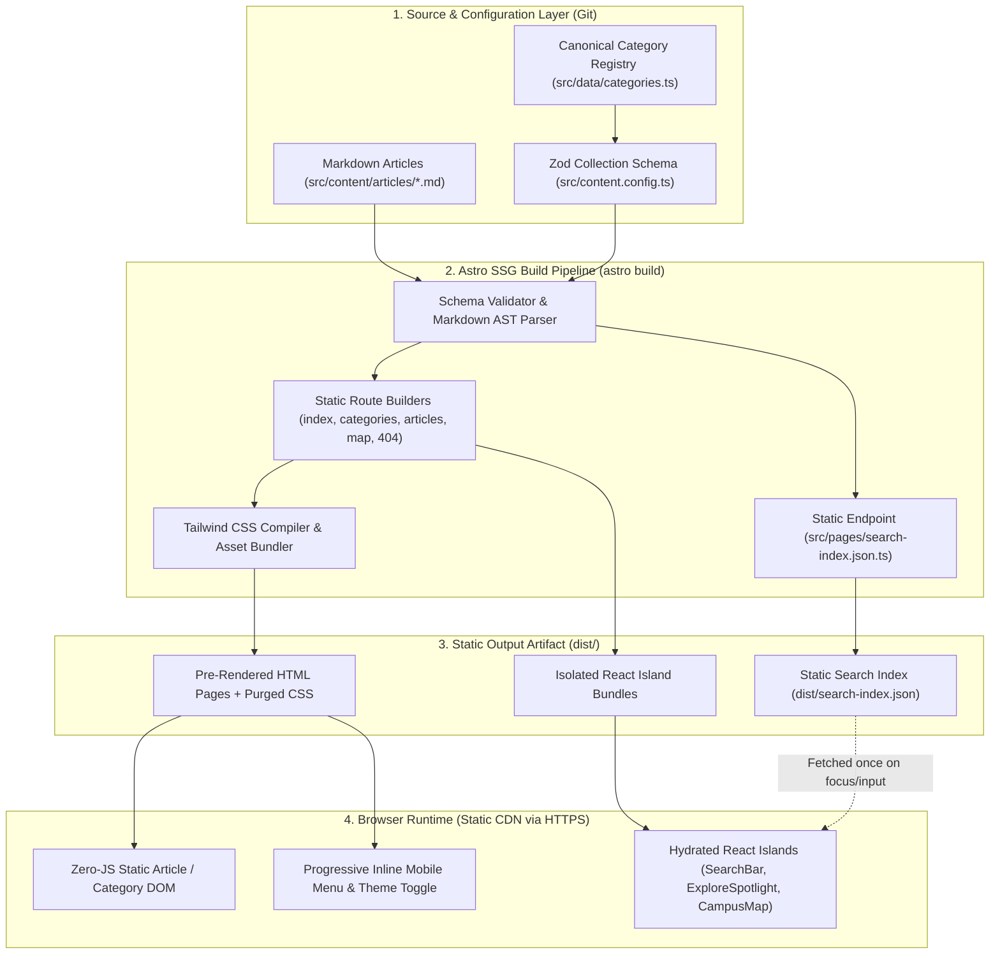
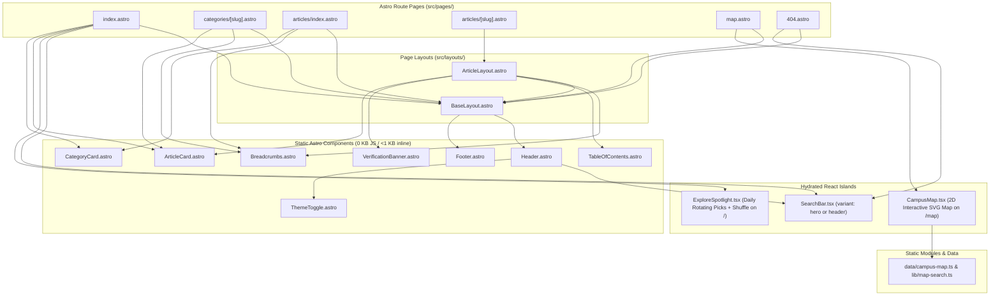

# Software architecture document: Geary - Unofficial BulSU Student Information Portal

## 1. Document control and architectural scope

| Attribute | Details |
| :--- | :--- |
| Document title | Software architecture document: Geary - Unofficial BulSU Student Information Portal |
| Version | `1.0 (MVP Baseline)` |
| Date | `2026-11-17` |
| Standard reference | ISO/IEC/IEEE 42010 (*Architecture description*) and ISO/IEC/IEEE 12207 Clause 6.4.3 (*Architecture Definition Process*) |
| Related baselines | [PROJECT_CHARTER.md](./PROJECT_CHARTER.md), [PRD.md](./PRD.md), [SRS.md](./SRS.md), [DESIGN_SYSTEM.md](./DESIGN_SYSTEM.md) |
| Status | Approved for repository scaffolding and multi-contributor development |

This document specifies Geary's technology stack, build-time versus runtime pipeline, Astro Islands hydration boundaries, component responsibilities, TypeScript and Zod contracts, and repository layout. Contributors working on content, UI components, or interactive islands share these boundaries so pull requests stay isolated and reviewable.

## 2. Technology stack

| Layer | Technology | Role in Geary | Architectural rationale |
| :--- | :--- | :--- | :--- |
| Runtime, package manager, and test runner | Bun (`bun.lock`, `bun test`) | Manages dependencies, runs `astro` CLI scripts, and executes pure TypeScript unit tests. | Fast single runtime with a built-in test runner and deterministic lockfile across contributor machines and CI. |
| Static site generator / meta-framework | Astro (`^7.4.12`, `output: 'static'`) | Compiles layouts, Content Collections, static routes, and JSON endpoints at build time. | Ships zero framework JavaScript on static content routes, keeping mobile loads fast and CDN hosting free. |
| Styling and design system | Tailwind CSS (`@tailwindcss/vite`) | Generates utility classes, semantic tokens, and scoped prose rules through Vite. | Produces small purged CSS bundles tied directly to [DESIGN_SYSTEM.md](./DESIGN_SYSTEM.md) tokens without runtime styling overhead. |
| Interactive UI islands | React (`@astrojs/react`) | Hydrates interactive islands (`SearchBar.tsx`, `ExploreSpotlight.tsx`, `CampusMap.tsx`) via `client:load`. | Confines React runtime cost to interactive surfaces while keeping article and category pages static. |
| Content and schema layer | Astro Content Collections + Markdown (`.md`) + TypeScript + Zod | Parses Git-tracked articles and validates frontmatter types at compile time. | Removes CMS and database dependencies while catching schema errors during local builds and PR CI runs. |
| Search index and scorer | Static JSON endpoint (`search-index.json.ts`) + TypeScript scorer | Emits a pre-built index at build time and scores queries synchronously in `SearchBar.tsx`. | Requires no external search SaaS and runs client-side matching with zero backend latency. |
| Deployment artifact | Vendor-neutral static `dist/` | Self-contained HTML, CSS, JS, and JSON output deployable to Cloudflare Pages, Vercel, Netlify, or GitHub Pages. | Avoids server adapters and hosting lock-in. |

## 3. High-level system and islands architecture

### 3.1 Build-time versus runtime pipeline

Geary separates build-time static compilation from runtime static delivery. Automated CI in `.github/workflows/ci.yml` runs the same build and test pipeline on every pull request so multiple contributors can edit articles and components safely.



### 3.2 Astro Islands hydration boundary

- Zero-JS static components: `BaseLayout.astro`, `ArticleLayout.astro`, `Header.astro`, `Footer.astro`, `Breadcrumbs.astro`, `CategoryCard.astro`, `ArticleCard.astro`, `TableOfContents.astro`, and `VerificationBanner.astro` compile to static HTML and CSS.
- Selective React hydration (`client:load`): `SearchBar.tsx` registers global keyboard shortcuts (`/`, `Ctrl+K` / `Cmd+K`) on load; `CampusMap.tsx` (on `/map`) handles interactive SVG pan, zoom, and office search; `ExploreSpotlight.tsx` (on `/`) renders 6 Featured articles cycling through 3 daily randomized groups seeded by local calendar date.
- Minimal progressive enhancement (`< 1 KB`): Mobile drawer state in `Header.astro` and theme switching in `ThemeToggle.astro` use small inline vanilla scripts, and mobile Table of Contents disclosure uses native HTML `<details>` and `<summary>`.

### 3.3 Content-to-build propagation

Adding or editing a single `.md` file in `src/content/articles/` updates four build outputs at once:

1. Article view (`/articles/[slug]`): Compiles Markdown prose, extracts `h2` and `h3` headings for TOC navigation, builds breadcrumbs, and resolves up to 3 sibling articles in the same category.
2. Category directory (`/categories/[slug]`): Updates article counts and groups the article card under its `subcategory` heading.
3. Home directory (`/`): Includes the article in the daily randomized 3x6 Featured pool.
4. Search payload (`/search-index.json`): Serializes the article's `slug`, `title`, `preview` (derived from the Markdown body), `category`, `categoryLabel`, `subcategory`, and `headings` array.

## 4. Component architecture and responsibilities

### 4.1 Component composition hierarchy



### 4.2 Module and component responsibilities

| Component / module | Type and hydration | Props / inputs | Responsibilities |
| :--- | :--- | :--- | :--- |
| `src/layouts/BaseLayout.astro` | Astro layout (`0 KB` JS) | `title`, `description?`, `activeCategory?`, `activeNav?`, `headerSearchShortcut?`, `ogType?`, `ogImageAlt?`, `articleMeta?`, `noindex?`, `jsonLd?` | Renders `<html lang="en">`, head theme bootstrap, document metadata, canonical `<link>`, Open Graph (`og:*`, `article:*`), Twitter cards (`twitter:image:alt`), optional JSON-LD `<script>`, robots meta, global CSS import, skip-to-content link, `<Header />`, `<main>`, and `<Footer />`. |
| `src/layouts/ArticleLayout.astro` | Astro layout (`0 KB` JS) | `article`, `categoryMeta`, `headings`, `relatedArticles` | Composes `BaseLayout`, `<Breadcrumbs />`, article metadata header, responsive grid pairing Markdown prose with `<TableOfContents />`, `<VerificationBanner />`, and up to 3 sibling `<ArticleCard />` items. |
| `src/components/Header.astro` | Static Astro + `< 1 KB` toggle | `activeCategory?: CategorySlug`, `showSearch?: boolean` | Renders brand logo (`/`), primary navigation links, compact `<SearchBar variant="header" client:load />`, `<ThemeToggle />`, and accessible mobile menu drawer toggle. |
| `src/components/ThemeToggle.astro` | Static Astro + `< 1 KB` script | None | Renders the accessible color theme menu (`Light`, `Dark`, `System default`) synced with `localStorage` (`geary-theme`) and the `<head>` bootstrap. |
| `src/components/Footer.astro` | Static Astro (`0 KB` JS) | Imports `CATEGORIES` | Renders global unofficial BulSU student information portal disclaimer and legal links. |
| `src/components/Breadcrumbs.astro` | Static Astro (`0 KB` JS) | `items: Array<{ label: string; href?: string }>` | Renders semantic breadcrumb trail linking parent routes and marking the current page. |
| `src/components/CategoryCard.astro` | Static Astro (`0 KB` JS) | `category: CategoryMeta`, `count: number`, `previewArticles: ArticleEntry[]` | Renders category summary card with icon, article count, up to 3 preview links, and `"Explore all ->"` route link. |
| `src/components/ArticleCard.astro` | Static Astro (`0 KB` JS) | `article: ArticleEntry`, `categoryMeta?: CategoryMeta`, `showCategoryBadge?: boolean` | Renders scannable article link card with title and 2-line body preview. |
| `src/components/TableOfContents.astro` | Static Astro (`0 KB` JS) | `headings: MarkdownHeading[]`, `mode: 'desktop' \| 'mobile'` | Filters `depth === 2 \|\| depth === 3`; renders nothing when `< 2` headings exist; outputs sticky sidebar (`desktop`) or `<details>` disclosure (`mobile`). |
| `src/components/VerificationBanner.astro` | Static Astro (`0 KB` JS) | `updatedDate: Date` | Displays official office verification notice and `updatedDate` at the bottom of articles. |
| `src/components/SearchBar.tsx` | React island (`client:load`) | `variant: 'hero' \| 'header'`, `enableGlobalShortcut?: boolean` | Lazily fetches and caches `/search-index.json` in module memory; calls the weighted literal substring scorer (`src/lib/search.ts`); manages keyboard navigation, outside-click dismissal, zero-match pills, and fetch-error fallback UI. |
| `src/components/ExploreSpotlight.tsx` | React island (`client:load`) | Article pool from `index.astro` | Displays 6 Featured articles cycling through 3 daily randomized groups seeded by local calendar date, with manual shuffle controls. |
| `src/components/CampusMap.tsx` | React island (`client:load`) | Data from `src/data/campus-map.ts` | Renders the interactive 2D BulSU Malolos SVG schematic, pan/zoom controls, office/facility search (`src/lib/map-search.ts`), and building inspector panel. |
| `src/lib/search.ts` | Pure TypeScript module | `items: SearchIndexItem[]`, `query: string` | Normalizes queries and scores multi-term matches (`title` > `headings`/`subcategory` > `preview`/`categoryLabel`); unit-tested without React DOM. |
| `src/lib/articles.ts` | Pure TypeScript module | `articles: ArticleEntry[]` | Groups articles deterministically by subcategory (`groupArticlesBySubcategory`) and selects related articles; shared by page templates and unit tests. |
| `src/lib/map-search.ts` | Pure TypeScript module | Campus map buildings/locations, `query: string` | Searches campus offices, facilities, and buildings for `CampusMap.tsx`; unit-tested in `tests/unit/map-search.test.ts`. |

## 5. Integrations and module contracts

### 5.1 Framework integrations (`astro.config.mjs`)

- `site` configuration: Reads `process.env.PUBLIC_SITE_URL`, falls back to Vercel URLs (`VERCEL_PROJECT_PRODUCTION_URL` / `VERCEL_URL`), and defaults locally to `https://geary.example.com`. Canonical URLs, Open Graph URLs, `robots.txt`, and sitemaps stay consistent across environments.
- `@astrojs/react`: Enables selective client hydration for React islands inside `.astro` files.
- `@astrojs/sitemap`: Generates `dist/sitemap-index.xml` at build time, excluding `/404` and non-HTML utility routes.
- Tailwind CSS (`@tailwindcss/vite`): Compiles utility classes and `src/styles/global.css` tokens through Astro's Vite plugin pipeline.
- `output: 'static'` and `build.inlineStylesheets: 'always'`: Pure SSG output targeting `dist/` with inlined CSS to avoid render-blocking stylesheet requests.

### 5.2 TypeScript data contracts

#### `src/data/categories.ts`

Single source of truth imported by Content Collection schemas, pages, navigation components, and `search-index.json.ts`:

```ts
export const CATEGORY_SLUGS = [
  'enrollment',
  'academics',
  'documents',
  'scholarships',
  'policies',
  'organizations',
  'campus',
] as const;

export type CategorySlug = (typeof CATEGORY_SLUGS)[number];

export interface CategoryMeta {
  slug: CategorySlug;
  title: string;
  description: string;
  icon: string;
  order: number;
}
```

#### `src/content.config.ts` (Astro Content Collection schema)

Defines the `articles` collection using Astro's Content Layer `glob` loader and Zod validation against `CATEGORY_SLUGS`:

```ts
import { defineCollection } from 'astro:content';
import { glob } from 'astro/loaders';
import { z } from 'astro/zod';
import { CATEGORY_SLUGS } from './data/categories';

export const articleSchema = z.object({
  title: z.string().min(1),
  category: z.enum(CATEGORY_SLUGS),
  subcategory: z.string().min(1),
  updatedDate: z.coerce.date(),
  source: z.string().min(1).optional(),
  sourceUrl: z.url().optional(),
});

export const collections = {
  articles: defineCollection({
    loader: glob({ pattern: '**/*.md', base: './src/content/articles' }),
    schema: articleSchema,
  }),
};
```

#### `src/pages/search-index.json.ts`

Build-time `GET` endpoint exporting static JSON conforming to `SearchIndexItem[]`:

```ts
export interface SearchIndexItem {
  slug: string;
  title: string;
  preview: string;
  category: CategorySlug;
  categoryLabel: string;
  subcategory: string;
  headings: string[];
}
```

### 5.3 External runtime integrations

Geary's core information portal has no external runtime dependencies: no databases, hosted search SaaS, LLM APIs, authentication services, or third-party tracking scripts. The `/contribute` page embeds a Google Form as an optional community submission surface; it is a documented governance exception that requires a team scope decision before expansion.

## 6. Project directory structure

```text
geary/
├── .github/
│   └── workflows/
│       └── ci.yml                   # PR & push CI pipeline (check, unit tests, build, E2E/Axe)
├── docs/                            # Authoritative ISO-aligned project specifications
│   ├── PROJECT_CHARTER.md           # ISO 12207 Project Charter
│   ├── PRD.md                       # Adapted ISO 29148 Product Requirements Document
│   ├── SRS.md                       # ISO 29148 / 25010 Software Requirements Specification
│   ├── USER_FLOWS.md                # ISO 29148 Operational Concept & User Flows
│   ├── ARCHITECTURE.md              # This Software Architecture Document
│   ├── TESTING.md                   # ISO 25010 / 29148 Lean Verification & Testing Spec
│   ├── DESIGN_SYSTEM.md             # ISO 25010 / WCAG 2.1 Design System Specification
│   ├── REQUIREMENTS.md              # ISO 29148 Master Requirements Traceability Matrix (RTM)
│   ├── ROADMAP.md                   # ISO 12207 Project Milestones, Backlog & Known Issues
│   └── WRITING_FRAMEWORK.md         # Editorial, tone & humanizer writing standard
├── AGENTS.md                        # Repository agent development instructions
├── README.md                        # Contributor quickstart, commands & spec index
├── package.json                     # Project dependencies & scripts (dev, check, build, test)
├── bun.lock                         # Bun deterministic dependency lockfile
├── bunfig.toml                      # Scopes `bun test` strictly to tests/unit/
├── playwright.config.ts             # Playwright E2E/Axe config (webServer -> astro preview)
├── astro.config.mjs                 # Astro static config + @astrojs/react + @tailwindcss/vite
├── tsconfig.json                    # Strict TypeScript compiler configuration
├── public/                          # Static assets copied verbatim to dist/
│   ├── apple-touch-icon.png         # 180x180 Geary touch icon for iOS / Android
│   ├── favicon-48x48.png            # 48x48 PNG favicon for Google Search & mobile
│   ├── favicon-96x96.png            # 96x96 high-DPI PNG favicon
│   ├── favicon.ico                  # Multi-size (16/32/48px) Geary fallback favicon
│   ├── favicon.svg                  # Minimalist Geary geometric gear icon
│   ├── googled56ea9e672e7afb1.html  # Google Search Console ownership verification
│   └── og-image.png                 # Shared 1200x630 Open Graph social preview card
├── tests/                           # Lean unit & Playwright E2E/Axe smoke tests
│   ├── unit/
│   │   ├── search.test.ts           # Bun test suite for query scoring & index contract
│   │   ├── articles.test.ts         # Bun test suite for subcategory grouping helpers
│   │   ├── map-search.test.ts       # Bun test suite for campus map search matching
│   │   └── seo.test.ts              # Bun test suite for JSON-LD builders & XSS escape
│   └── e2e/
│       └── smoke.spec.ts            # Playwright + Axe smoke, SEO, TOC, overflow & 404 tests
└── src/
    ├── styles/
    │   └── global.css               # Tailwind import, design tokens, scoped prose styles
    ├── data/
    │   ├── categories.ts            # Canonical 7-category registry & lookup helpers
    │   └── campus-map.ts            # BulSU Malolos building footprints & office directory data
    ├── lib/
    │   ├── search.ts                # Pure query normalization & weighted scoring engine
    │   ├── articles.ts              # Subcategory grouping & sibling article helpers
    │   ├── map-search.ts            # Pure office/building lookup helpers for /map
    │   └── seo.ts                   # Pure JSON-LD builders (WebSite, Article, BreadcrumbList)
    ├── content.config.ts            # Astro Content Collection + Zod schema (`articles`)
    ├── content/
    │   └── articles/                # 30 UTF-8 handbook-verified Markdown articles
    ├── layouts/
    │   ├── BaseLayout.astro         # Global HTML shell, theme bootstrap, Header & Footer
    │   └── ArticleLayout.astro      # Constrained prose reading layout, TOC & related
    ├── components/
    │   ├── Header.astro             # Global navbar, gear logo, mobile menu, Header SearchBar
    │   ├── ThemeToggle.astro        # Accessible Light / Dark / System theme menu
    │   ├── Footer.astro             # Unofficial disclaimer & legal links
    │   ├── Breadcrumbs.astro        # Hierarchical Home > Category > Article navigation
    │   ├── CategoryCard.astro       # Directory card with count & preview links
    │   ├── ArticleCard.astro        # Scannable article summary card
    │   ├── TableOfContents.astro    # Conditional h2/h3 TOC (sticky desktop / <details> mobile)
    │   ├── VerificationBanner.astro # Official office verification notice
    │   ├── SearchBar.tsx            # Hydrated React island consuming /search-index.json
    │   ├── ExploreSpotlight.tsx     # Hydrated React island for daily Featured articles on /
    │   └── CampusMap.tsx            # Hydrated React island for interactive 2D SVG map on /map
    └── pages/
        ├── index.astro              # Home portal (Hero SearchBar, Featured Articles)
        ├── map.astro                # Interactive 2D BulSU Malolos Campus Map island
        ├── contribute.astro         # Community submission page with embedded Google Form
        ├── terms.astro              # Terms of Service & unofficial disclaimer page
        ├── privacy.astro            # Privacy Policy (zero-tracking static architecture)
        ├── 404.astro                # Branded recovery page with SearchBar & categories (`noindex`)
        ├── robots.txt.ts            # Build-time generator referencing Astro.site sitemap
        ├── search-index.json.ts     # Build-time generator for /search-index.json
        ├── categories/
        │   └── [slug].astro         # Subcategory-grouped category directory pages
        └── articles/
            ├── index.astro          # Articles & categories directory page (7 CategoryCards)
            └── [slug].astro         # Individual Markdown article pages
```
