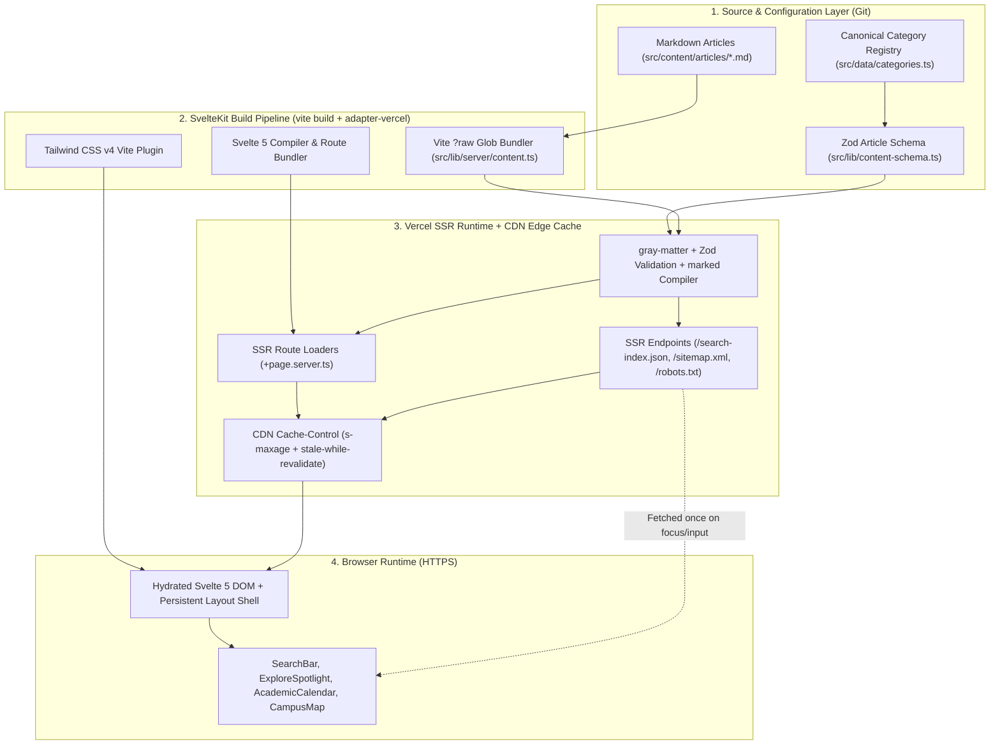

# Software architecture document: Geary - Unofficial BulSU Student Information Portal

## 1. Document control and architectural scope

| Attribute | Details |
| :--- | :--- |
| Document title | Software architecture document: Geary - Unofficial BulSU Student Information Portal |
| Version | `2.0 (SvelteKit SSR Architecture)` |
| Date | `2026-11-24` |
| Standard reference | ISO/IEC/IEEE 42010 (*Architecture description*) and ISO/IEC/IEEE 12207 Clause 6.4.3 (*Architecture Definition Process*) |
| Related baselines | [PROJECT_CHARTER.md](./PROJECT_CHARTER.md), [PRD.md](./PRD.md), [SRS.md](./SRS.md), [DESIGN_SYSTEM.md](./DESIGN_SYSTEM.md) |
| Status | Approved for SvelteKit SSR migration |

This document specifies Geary's technology stack, SSR and edge-caching pipeline, Markdown content ingestion pipeline, Svelte 5 component responsibilities, TypeScript and Zod contracts, and repository layout. Contributors working on content, routes, or UI components share these boundaries so pull requests stay isolated and reviewable.

## 2. Technology stack

| Layer | Technology | Role in Geary | Architectural rationale |
| :--- | :--- | :--- | :--- |
| Runtime, package manager, and test runner | Bun (`bun.lock`, `bun test`) | Manages dependencies, runs SvelteKit/Vite CLI scripts, and executes pure TypeScript unit tests. | Fast single runtime with a built-in test runner and deterministic lockfile across contributor machines and CI. |
| Meta-framework & SSR engine | SvelteKit + Svelte 5 (runes) | Renders routes, layouts, error pages, and server endpoints (`+page.server.ts`, `+server.ts`) dynamically on demand. | Unified `.svelte` component model across static markup and interactive UI with fine-grained runes reactivity and zero React runtime overhead. |
| Deployment adapter | `@sveltejs/adapter-vercel` | Targets Vercel serverless SSR with CDN `Cache-Control` (`s-maxage` + `stale-while-revalidate`) edge caching. | Keeps `$0.00/month` free-tier hosting while unlocking dynamic SSR routes and endpoints without vendor lock-in inside app code. |
| Styling and design system | Tailwind CSS v4 (`@tailwindcss/vite`) | Generates utility classes, semantic tokens, and scoped prose rules through Vite. | Produces small purged CSS bundles tied directly to [DESIGN_SYSTEM.md](./DESIGN_SYSTEM.md) tokens without runtime styling overhead. |
| Content and schema layer | Vite `?raw` glob + `gray-matter` + `marked` + `zod` | Bundles `src/content/articles/**/*.md` into the SSR server bundle, validates YAML frontmatter with Zod, extracts `h2`/`h3` headings + plain-text previews, and compiles GFM HTML. | Single-pass Markdown ingestion with zero database dependencies and zero Svelte template syntax collisions in `.md` prose. |
| Search index and scorer | SSR JSON endpoint (`src/routes/search-index.json/+server.ts`) + TypeScript scorer | Serves an edge-cached JSON index built via pure `buildSearchIndex()` and scores queries synchronously in `SearchBar.svelte`. | Requires no external search SaaS and runs client-side matching with zero backend latency. |

## 3. High-level system and SSR architecture

### 3.1 Build-time versus runtime pipeline

Geary bundles Git-tracked Markdown sources directly into the SvelteKit SSR build via Vite `?raw` glob imports, then serves edge-cached HTML, XML, and JSON responses on Vercel. Automated CI in `.github/workflows/ci.yml` runs typechecks (`svelte-check`), unit tests (`bun test`), and the SvelteKit production build (`vite build`) on every pull request.



### 3.2 SSR, hydration, and caching boundary

- **Dynamic SSR with CDN edge caching:** All page routes (`+page.server.ts`) and data endpoints (`/search-index.json`, `/sitemap.xml`, `/robots.txt`) set `Cache-Control: public, max-age=0, s-maxage=3600, stale-while-revalidate=86400` via `setHeaders()` / `Response` headers so Vercel's CDN serves repeat hits from the edge while keeping SSR dynamic.
- **Unified Svelte 5 components:** Layouts (`+layout.svelte`), navigation (`Header.svelte`, `Footer.svelte`, `ThemeToggle.svelte`), reading views (`ArticleLayout.svelte`, `TableOfContents.svelte`), and interactive widgets (`SearchBar.svelte`, `ExploreSpotlight.svelte`, `AcademicCalendar.svelte`, `CampusMap.svelte`) are all authored in Svelte 5 runes (`$state`, `$derived`, `$effect`, `$props`).
- **No-flash theme bootstrap:** `src/app.html` runs a minimal synchronous inline script before first paint to apply the `dark` class from `localStorage` (`geary-theme`) or `prefers-color-scheme`, synchronized with `ThemeToggle.svelte`.
- **SPA-safe lifecycle cleanup:** Because SvelteKit keeps `+layout.svelte` mounted across client-side route transitions, global keyboard listeners (`/` and `Ctrl/Cmd+K` via `src/lib/search-shortcut.ts`), timers, and `<canvas>` animations clean up deterministically inside `$effect` teardowns.

### 3.3 Content-to-route propagation

Adding or editing a single `.md` file in `src/content/articles/` automatically propagates through `src/lib/server/content.ts` to five surfaces:

1. **Article view (`/articles/[slug]`):** Validates frontmatter with Zod, compiles Markdown prose via `marked` with unique heading `id`s, extracts `h2`/`h3` headings for TOC navigation, builds breadcrumbs, and resolves up to 3 sibling articles in the same category.
2. **Category directory (`/categories/[slug]`):** Updates article counts and groups article cards under alphabetical `subcategory` headings.
3. **Articles index (`/articles`):** Updates all 7 category counts and top-3 preview links.
4. **Home hero (`/`):** Includes the article in the daily randomized 3x3 single-row hero spotlight pool (`ExploreSpotlight.svelte`).
5. **Search & sitemap endpoints (`/search-index.json`, `/sitemap.xml`):** Serializes the article's `slug`, `title`, body `preview`, `category`, `categoryLabel`, `subcategory`, and `headings` array via pure `buildSearchIndex()`, and lists the canonical URL in `/sitemap.xml`.

## 4. Component architecture and responsibilities

### 4.1 Component composition hierarchy

```mermaid
flowchart TD
    subgraph Routes["SvelteKit Routes (src/routes/)"]
        R_LAY["+layout.svelte"]
        R_ERR["+error.svelte (HTTP 404)"]
        R_HOME["+page.svelte (/)"]
        R_CAT["categories/[slug]/+page.svelte"]
        R_ART_IDX["articles/+page.svelte"]
        R_ART["articles/[slug]/+page.svelte"]
        R_CAL["calendar/+page.svelte"]
        R_MAP["map/+page.svelte"]
    end

    subgraph Components["Svelte 5 Components (src/lib/components/)"]
        C_HDR["Header.svelte"]
        C_THM["ThemeToggle.svelte"]
        C_FTR["Footer.svelte"]
        C_BC["Breadcrumbs.svelte"]
        C_CCARD["CategoryCard.svelte"]
        C_ACARD["ArticleCard.svelte"]
        C_TOC["TableOfContents.svelte"]
        C_ARTL["ArticleLayout.svelte"]
        C_SRCH["SearchBar.svelte"]
        C_EXPL["ExploreSpotlight.svelte"]
        C_CAL["AcademicCalendar.svelte"]
        C_MAP["CampusMap.svelte + campus-map/*"]
    end

    subgraph ServerAndDomain["Server Loader & Pure Domain Modules"]
        S_CNT["lib/server/content.ts (Vite ?raw glob + gray-matter + marked + zod)"]
        D_CORE["lib/articles.ts, search.ts, calendar.ts, map-search.ts, seo.ts"]
        D_DATA["data/categories.ts, campus-map.ts, academic-calendar.ts"]
    end

    R_LAY --> C_HDR
    R_LAY --> C_FTR
    C_HDR --> C_SRCH
    C_HDR --> C_THM

    R_HOME --> C_SRCH
    R_HOME --> C_EXPL
    R_CAT --> C_BC
    R_CAT --> C_ACARD
    R_ART_IDX --> C_BC
    R_ART_IDX --> C_CCARD
    R_ART --> C_ARTL
    C_ARTL --> C_BC
    C_ARTL --> C_TOC
    C_ARTL --> C_ACARD
    R_CAL --> C_CAL
    R_MAP --> C_MAP
    R_ERR --> C_SRCH

    S_CNT --> D_CORE
    C_MAP --> D_DATA
    C_CAL --> D_DATA
```



### 4.2 Module and component responsibilities

| Component / module | Layer | Props / inputs | Responsibilities |
| :--- | :--- | :--- | :--- |
| `src/app.html` | Root HTML shell | SvelteKit `%sveltekit.head%` / `%sveltekit.body%` | Loads no-flash theme bootstrap script, favicons, and root document attributes. |
| `src/routes/+layout.svelte` | Root SvelteKit layout | `children` snippet + route metadata from `page.data` | Renders skip-to-content link, `<Header />`, `<main>`, and `<Footer />`, plus global CSS and font preloads. |
| `src/lib/components/SeoHead.svelte` | Svelte 5 component | `title`, `description`, `canonicalUrl`, `ogType`, `ogImageUrl`, `ogImageAlt`, `articleMeta?`, `noindex?`, `jsonLd?` | Renders `<svelte:head>` title, description, canonical link, Open Graph (`og:*`, `article:*`), Twitter cards, robots meta, and safe serialized JSON-LD scripts. |
| `src/lib/components/ArticleLayout.svelte` | Svelte 5 component | `article`, `html`, `categoryMeta`, `headings`, `relatedArticles` | Composes `<Breadcrumbs />`, article metadata header, responsive grid pairing `{@html html}` prose with `<TableOfContents />`, optional Source card, unofficial verification notice, and up to 3 sibling `<ArticleCard />` items. |
| `src/lib/components/Header.svelte` | Svelte 5 component | `activeCategory?`, `activeNav?`, `headerSearchShortcut?` | Renders brand gear logo (`/`), primary navigation links (`Home`, `Articles`, `Academic Calendar`, `Campus Map`, `Contribute`), compact `<SearchBar variant="header" />`, `<ThemeToggle />`, and accessible mobile menu drawer. |
| `src/lib/components/ThemeToggle.svelte` | Svelte 5 component | None | Renders accessible color theme menu (`Light`, `Dark`, `System default`) synced with `localStorage` (`geary-theme`) and `src/app.html` bootstrap. |
| `src/lib/components/Footer.svelte` | Svelte 5 component | None | Renders global footer copyright and legal links (`/terms`, `/privacy`). |
| `src/lib/components/Breadcrumbs.svelte` | Svelte 5 component | `items: Array<{ label: string; href?: string }>` | Renders semantic breadcrumb trail linking parent routes and marking the current page (`aria-current="page"`). |
| `src/lib/components/CategoryCard.svelte` | Svelte 5 component | `category: CategoryMeta`, `count: number`, `previewArticles` | Renders category summary card with icon, article count, up to 3 preview links, and category route link. |
| `src/lib/components/ArticleCard.svelte` | Svelte 5 component | `article`, `categoryMeta?`, `showCategoryBadge?` | Renders scannable article link card with title and 2-line body preview. |
| `src/lib/components/TableOfContents.svelte` | Svelte 5 component | `headings: MarkdownHeading[]`, `mode: 'desktop' \| 'mobile'` | Filters `depth === 2 \|\| depth === 3`; renders nothing when `< 2` headings exist; outputs sticky sidebar (`desktop`) or `<details>` disclosure (`mobile`). |
| `src/lib/components/SearchBar.svelte` | Svelte 5 component | `variant: 'hero' \| 'header'`, `enableGlobalShortcut?: boolean` | Lazily fetches and caches `/search-index.json` in module memory; calls `filterAndRankArticles` (`src/lib/search.ts`); manages keyboard navigation, outside-click dismissal, zero-match category pills, and fetch-error fallback UI. |
| `src/lib/components/ExploreSpotlight.svelte` | Svelte 5 component | `items`, `initialDateKey`, `groupSize = 3`, `groupCount = 3` | Displays 3 articles in a single row at the bottom of the Home hero, cycling automatically through 3 daily randomized groups (9 articles/day) with no manual controls and pausing on hover/focus/reduced-motion. |
| `src/lib/components/AcademicCalendar.svelte` | Svelte 5 component | Data from `src/data/academic-calendar.ts` | Renders the searchable, category-filterable AY 2026–2027 BulSU Academic Calendar grouped by month on `/calendar`, with sticky filter bar, month jump nav, `/` & `Ctrl/Cmd+K` shortcut, and floating back-to-top button. |
| `src/lib/components/CampusMap.svelte` | Svelte 5 component | Data from `src/data/campus-map.ts` | Renders the full-bleed interactive 2D BulSU Malolos SVG schematic, floating search (`campus-map/CampusMapSearch.svelte`), desktop card / mobile bottom-sheet inspector (`campus-map/BuildingInspector.svelte`), and pan/zoom viewport state (`campus-map/viewport.svelte.ts`). |
| `src/lib/server/content.ts` | Server content module | Bundled `src/content/articles/**/*.md` via Vite `?raw` glob | Parses YAML frontmatter (`gray-matter`), validates via `articleSchema` (`zod`), compiles GFM Markdown + unique heading IDs (`marked`), extracts `headings` and plain-text `preview`, and exposes `getAllArticles()`, `getArticleBySlug()`, and `buildSearchIndex()`. |
| `src/lib/search.ts` | Pure TypeScript module | `items: SearchIndexItem[]`, `query: string` | Normalizes queries and scores multi-term literal substring matches (`title` > `headings`/`subcategory` > `preview`/`categoryLabel`). |
| `src/lib/articles.ts` | Pure TypeScript module | Articles list | Subcategory grouping, daily deterministic shuffle/partitioning (`getDailyItemGroups`), sibling selection, preview extraction, and UTC date formatting. |
| `src/lib/calendar.ts` | Pure TypeScript module | Calendar events, filters, query | Multi-category filtering, multi-token search, and chronological month grouping for `/calendar`. |
| `src/lib/map-search.ts` | Pure TypeScript module | Campus map buildings/locations, query | Location/building search, floor partitioning/grouping, and clamped SVG viewBox pan/zoom math. |
| `src/lib/seo.ts` | Pure TypeScript module | Route metadata & origin | Canonical origin resolution and XSS-safe JSON-LD builders (`WebSite`, `BreadcrumbList`, `Article`). |

## 5. Configuration and module contracts

### 5.1 Framework configuration (`vite.config.ts`)

- **`vite.config.ts`:** Configures `validateArticlesPlugin()` (fail-fast Zod validation of all `src/content/articles/*.md` on build), `tailwindcss()` (`@tailwindcss/vite`), and `sveltekit({ adapter })` with `@sveltejs/adapter-vercel` (`runtime: 'nodejs22.x'`, SvelteKit 3 unified Vite config without `svelte.config.js`).
- **Subpath imports (`package.json`):** Uses `#lib/*` (`./src/lib/*`) per SvelteKit 3 conventions.
- **Origin resolution (`src/lib/seo.ts`):** Reads `PUBLIC_SITE_URL`, falls back to `VERCEL_PROJECT_PRODUCTION_URL` / `VERCEL_URL` / incoming request `url.origin`, and defaults locally to `https://geary.example.com`.
- **CDN cache headers (`src/lib/server/cache.ts`):** Shared `CACHE_CONTROL_HEADER = 'public, max-age=0, s-maxage=3600, stale-while-revalidate=86400'` applied across SSR page loaders and `/search-index.json`, `/sitemap.xml`, and `/robots.txt`.

### 5.2 TypeScript and Zod data contracts

#### `src/data/categories.ts`

Single source of truth imported by Zod schemas, routes, navigation components, and `buildSearchIndex()`:

```ts
export const CATEGORY_SLUGS = [
  'enrollment',
  'academics',
  'documents',
  'scholarships',
  'policies',
  'organizations',
  'campus',
] as const;

export type CategorySlug = (typeof CATEGORY_SLUGS)[number];

export interface CategoryMeta {
  slug: CategorySlug;
  title: string;
  description: string;
  icon: string;
  order: number;
}
```

#### `src/lib/content-schema.ts` (Zod article schema)

```ts
import { z } from 'zod';
import { CATEGORY_SLUGS } from '../data/categories';

const httpUrlSchema = z.url({ protocol: /^https?$/ });

export const articleSourceSchema = z.object({
  label: z.string().min(1),
  url: httpUrlSchema.optional(),
});

export const articleSchema = z.object({
  title: z.string().min(1),
  category: z.enum(CATEGORY_SLUGS),
  subcategory: z.string().min(1),
  updatedDate: z.coerce.date(),
  source: z.string().min(1).optional(),
  sourceUrl: httpUrlSchema.optional(),
  sources: z.array(articleSourceSchema).min(1).optional(),
});
```

#### `src/routes/search-index.json/+server.ts`

Edge-cached SSR `GET` endpoint returning JSON conforming to `SearchIndexItem[]`:

```ts
export interface SearchIndexItem {
  slug: string;
  title: string;
  preview: string;
  category: CategorySlug;
  categoryLabel: string;
  subcategory: string;
  headings: string[];
}
```

### 5.3 External runtime integrations

Geary's core information portal has no external runtime dependencies: no databases, hosted search SaaS, LLM APIs, authentication services, or third-party tracking scripts. The `/contribute` page embeds a Google Form as an optional community submission surface; it is a documented governance exception that requires a team scope decision before expansion.

## 6. Project directory structure

```text
geary/
├── .github/
│   └── workflows/
│       └── ci.yml                   # PR & push CI pipeline (check, unit tests, build)
├── docs/                            # Authoritative ISO-aligned project specifications
│   ├── PROJECT_CHARTER.md           # ISO 12207 Project Charter
│   ├── PRD.md                       # Adapted ISO 29148 Product Requirements Document
│   ├── SRS.md                       # ISO 29148 / 25010 Software Requirements Specification
│   ├── USER_FLOWS.md                # ISO 29148 Operational Concept & User Flows
│   ├── ARCHITECTURE.md              # This Software Architecture Document
│   ├── TESTING.md                   # ISO 25010 / 29148 Lean Verification & Testing Spec
│   ├── DESIGN_SYSTEM.md             # ISO 25010 / WCAG 2.1 Design System Specification
│   ├── REQUIREMENTS.md              # ISO 29148 Master Requirements Traceability Matrix (RTM)
│   ├── ROADMAP.md                   # ISO 12207 Project Milestones, Backlog & Known Issues
│   └── WRITING_FRAMEWORK.md         # Editorial, tone & humanizer writing standard
├── AGENTS.md                        # Repository agent development instructions
├── README.md                        # Contributor quickstart, commands & spec index
├── package.json                     # Project dependencies & scripts (dev, check, build, preview, test)
├── bun.lock                         # Bun deterministic dependency lockfile
├── bunfig.toml                      # Scopes `bun test` strictly to tests/unit/
├── playwright.config.ts             # Playwright E2E/Axe config (webServer -> vite preview)
├── vite.config.ts                   # Vite 8 + Tailwind v4 + SvelteKit 3 + @sveltejs/adapter-vercel
├── tsconfig.json                    # Strict TypeScript config extending $app/tsconfig
├── static/                          # Static assets served from site root (favicons, logos, OG image, banners)
│   ├── apple-touch-icon.png
│   ├── favicon-48x48.png
│   ├── favicon-96x96.png
│   ├── favicon.ico
│   ├── favicon.svg
│   ├── geary-logo-dark.svg
│   ├── geary-logo-light.svg
│   ├── googled56ea9e672e7afb1.html
│   ├── og-image.png
│   └── santa-hat.png
├── tests/                           # Unit & Playwright E2E/Axe verification suites
│   ├── unit/
│   │   ├── articles.test.ts         # Subcategory grouping, previews, daily spotlight & UTC dates
│   │   ├── calendar.test.ts         # AY 2026-2027 calendar dataset, filtering & month grouping
│   │   ├── content.test.ts          # Zod frontmatter validation & Markdown compilation + headings
│   │   ├── map-search.test.ts       # Campus map search, directory integrity & viewBox math
│   │   ├── search.test.ts           # Query scoring & pure buildSearchIndex() contract (< 100 KB)
│   │   └── seo.test.ts              # JSON-LD builders & XSS-safe serialization
│   └── e2e/
│       └── smoke.spec.ts            # Playwright + Axe smoke, SEO, TOC, overflow, dark mode & 404 tests
└── src/
    ├── app.html                     # Root HTML shell with synchronous theme bootstrap
    ├── styles/
    │   └── global.css               # Tailwind v4 import, design tokens & scoped prose styles
    ├── content/
    │   └── articles/                # UTF-8 handbook-verified Markdown articles
    ├── data/
    │   ├── academic-calendar.ts     # AY 2026-2027 BulSU academic calendar events
    │   ├── campus-map.ts            # BulSU Malolos building footprints & office directory data
    │   └── categories.ts            # Canonical 7-category registry & lookup helpers
    ├── lib/
    │   ├── articles.ts              # Subcategory grouping, daily spotlight & sibling article helpers
    │   ├── calendar.ts              # Calendar category/search filtering & month grouping
    │   ├── content-schema.ts        # Zod article frontmatter & source schemas
    │   ├── map-search.ts            # Office/building lookup & viewBox math helpers for /map
    │   ├── search-shortcut.ts       # Shared `/` and `Ctrl/Cmd+K` global shortcut binder
    │   ├── search.ts                # Pure query normalization & weighted scoring engine
    │   ├── seo.ts                   # Pure JSON-LD builders & canonical origin resolution
    │   ├── server/
    │   │   ├── cache.ts             # Shared CDN Cache-Control header constants
    │   │   ├── content.ts           # Vite ?raw glob + gray-matter + zod + marked loader + buildSearchIndex()
    │   │   └── markdown.ts          # Pure Markdown parser + heading slug extractor (unit-testable)
    │   └── components/
    │       ├── AcademicCalendar.svelte
    │       ├── ArticleCard.svelte
    │       ├── ArticleLayout.svelte
    │       ├── Breadcrumbs.svelte
    │       ├── CampusMap.svelte
    │       ├── CategoryCard.svelte
    │       ├── ExploreSpotlight.svelte
    │       ├── Footer.svelte
    │       ├── Header.svelte
    │       ├── SearchBar.svelte
    │       ├── SeoHead.svelte
    │       ├── TableOfContents.svelte
    │       ├── ThemeToggle.svelte
    │       └── campus-map/          # CampusMapSearch.svelte, BuildingInspector.svelte, viewport.svelte.ts
    └── routes/
        ├── +layout.svelte           # Global shell (Header, main, Footer) + theme/route coordination
        ├── +error.svelte            # Branded HTTP 404 recovery page with SearchBar & categories (`noindex`)
        ├── +page.server.ts          # Home hero spotlight pool loader + CDN Cache-Control
        ├── +page.svelte             # Home portal (Hero SearchBar, snow canvas, 3-card daily spotlight)
        ├── articles/
        │   ├── +page.server.ts      # 7-category counts & previews + CDN Cache-Control
        │   ├── +page.svelte         # Articles & categories directory page (7 CategoryCards)
        │   └── [slug]/
        │       ├── +page.server.ts  # Article resolver, compiled HTML, headings, related + Cache-Control
        │       └── +page.svelte     # Individual Markdown article page
        ├── calendar/
        │   ├── +page.server.ts      # Cache-Control header setup
        │   └── +page.svelte         # Interactive AY 2026-2027 BulSU Academic Calendar
        ├── categories/
        │   └── [slug]/
        │       ├── +page.server.ts  # Category resolver & grouped articles + Cache-Control
        │       └── +page.svelte     # Subcategory-grouped category directory page
        ├── contribute/
        │   ├── +page.server.ts
        │   └── +page.svelte         # Community submission page with embedded Google Form
        ├── map/
        │   ├── +page.server.ts
        │   └── +page.svelte         # Full-viewport interactive 2D BulSU Malolos Campus Map
        ├── privacy/
        │   ├── +page.server.ts
        │   └── +page.svelte         # Privacy Policy page
        ├── terms/
        │   ├── +page.server.ts
        │   └── +page.svelte         # Terms of Service & unofficial disclaimer page
        ├── robots.txt/
        │   └── +server.ts           # Edge-cached robots.txt referencing sitemap.xml
        ├── search-index.json/
        │   └── +server.ts           # Edge-cached JSON search payload from buildSearchIndex()
        └── sitemap.xml/
            └── +server.ts           # Edge-cached XML sitemap listing all canonical routes
```
