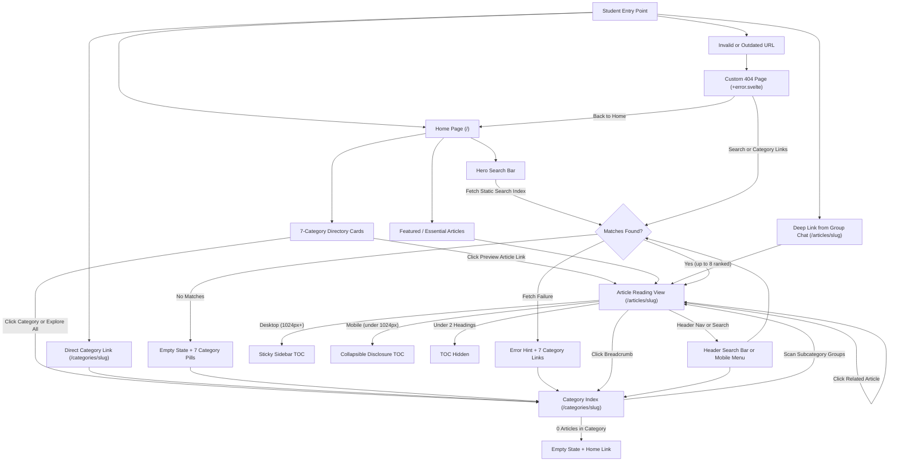
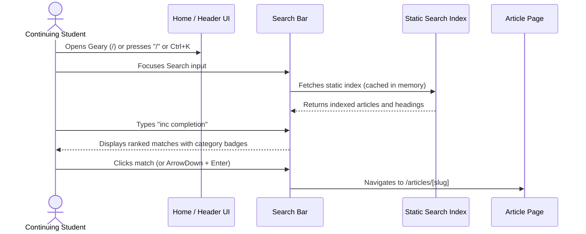

# User flows and operational scenarios: Geary - Unofficial BulSU Student Information Portal

## 1. Document control and operational context (ISO/IEC/IEEE 29148 Clauses 9.3.1, 9.3.2, and 9.3.4)

### 1.1 Document identification

| Attribute | Details |
| :--- | :--- |
| Document title | User flows and operational scenarios: Geary - Unofficial BulSU Student Information Portal |
| Version | `1.0 (MVP Baseline)` |
| Date | `2026-11-17` |
| Standard reference | Adapted from ISO/IEC/IEEE 29148:2018, *Systems and software engineering - Life cycle processes - Requirements engineering* (Clause 9.3 *Operational Concept [OpsCon]*, Clause 9.3.4 *Operational Modes*, Clause 9.3.5 *Operational Scenarios*, and Clauses 6.2/6.3 *Use-Case Modeling*) |
| Related baselines | [PROJECT_CHARTER.md](./PROJECT_CHARTER.md), [PRD.md](./PRD.md), [SRS.md](./SRS.md) |
| Status | Approved for implementation and UX verification |

### 1.2 Purpose and actors

This specification covers Geary's operational modes (`MODE-01` to `MODE-04`), master navigation flow, end-to-end user journeys (`UJ-01` to `UJ-06`), use cases (`UC-01` to `UC-06`), alternative flows (`AF-*`), exception flows (`EF-*`), and off-nominal error scenarios (`ERR-01` to `ERR-09`), including campus map lookup.

Actors are defined in [PROJECT_CHARTER.md](./PROJECT_CHARTER.md) Section 5:

- `ACT-01`: Incoming Freshman
- `ACT-02`: Shiftee / Transferee
- `ACT-03`: Continuing Undergraduate
- `ACT-04`: Student Maintainer / Contributor (part of the multi-contributor student team reviewing and shipping updates through pull requests)

### 1.3 Operational modes (`MODE-01` to `MODE-04`) (ISO/IEC/IEEE 29148 Clause 9.3.4)

| Mode ID | Operational mode | Activation condition | Expected behavior |
| :--- | :--- | :--- | :--- |
| `MODE-01` | Nominal SSR browsing and reading | Student opens `/`, `/categories/[slug]`, or `/articles/[slug]`. | Server-rendered HTML (edge-cached) loads immediately with category browsing, article reading, and table-of-contents and menu controls. |
| `MODE-02` | Interactive client search and map lookup | Student focuses the Search Bar, presses `/` or `Ctrl+K` (`Cmd+K`), or interacts with `/map`. | Client-side search fetches and caches `/search-index.json`, ranks multi-term queries, and supports keyboard navigation; `/map` runs local building search and SVG focus. |
| `MODE-03` | Degraded / off-nominal recovery | Search returns zero matches, the search index fails to load on weak mobile data, or a student hits a broken URL. | The interface shows recovery options: category quick-jump links, retry guidance, or the branded `404` page. |
| `MODE-04` | Build-time content authoring and PR validation | A contributor adds or edits a Markdown article and runs the build locally or opens a pull request. | Zod schema validation checks frontmatter, SvelteKit builds cleanly, unit tests validate the search index payload, and CI checks run before merge. |

## 2. Master navigation and state transition diagram (ISO/IEC/IEEE 29148 Clause 9.3.4)

## 3. Operational scenarios and end-to-end user journeys (`UJ-01` to `UJ-06`) (ISO/IEC/IEEE 29148 Clause 9.3.5)

### `UJ-01`: Urgent search-first lookup (checking `INC` or `TOR`)

- Actor: `ACT-03` (Continuing Undergraduate on mobile between classes)
- Trigger: The student needs the deadline and office window to complete an `INC` grade or request a `TOR`.
- Operational mode: `MODE-01` -> `MODE-02` -> `MODE-01`
- Steps:
  1. The student opens `/` on mobile, where the Hero Search Bar sits above the fold.
  2. Tapping the input lazily fetches and caches the static search index once in memory.
  3. The student types `"inc completion"` (or `"tor"`).
  4. The top match appears with its *Registrar & Documents* category badge and preview.
  5. The student taps the result and lands on the target article to read the steps.
- Expected outcome: The student finds the required office procedure in seconds with no backend round trip.

### `UJ-02`: Category and subcategory browsing (enrollment or campus spots)

- Actor: `ACT-01` (Incoming Freshman) or `ACT-02` (Shiftee / Transferee)
- Trigger: The student does not know BulSU's exact administrative terms yet and wants to browse enrollment steps or campus food spots.
- Operational mode: `MODE-01`
- Steps:
  1. The student opens `/` and scrolls past the search bar to the 7-category directory.
  2. They scan category descriptions, article counts, and preview links.
  3. They open *Enrollment* (`/categories/enrollment`).
  4. Articles appear grouped under `subcategory` headings (such as *Freshmen*, *Shifting & Transferring*, and *Returning / LOA*).
  5. They read the short previews and open *How to Shift Programs in BulSU*.
- Expected outcome: The student locates the right procedure through a clear hierarchy without guessing university jargon.

### `UJ-03`: Mobile deep-link skimming from a group chat (`375px` viewport)

- Actor: `ACT-03` (Continuing Undergraduate)
- Trigger: A classmate shares a direct article URL (for example, `/articles/can-i-graduate-with-honors`) in a group chat, and the student only wants the GWA table.
- Operational mode: `MODE-01`
- Steps:
  1. The student opens the link on a `375px` phone screen.
  2. Breadcrumbs (`Home > Handbook & Policies > Can I Graduate with Honors?`), the category badge, the title, and the *Last Updated* date establish context immediately.
  3. Below the header sits the collapsed `"On this page"` disclosure panel.
  4. The student expands it, taps the GWA section link, and jumps straight to the table.
  5. The student swipes horizontally inside the table container without triggering page-wide horizontal scroll.
  6. At the bottom, a verification reminder advises confirming official rules with the Registrar, followed by up to 3 sibling *Related Articles in This Category*.
- Expected outcome: The reader reaches the table quickly on a narrow screen with zero page overflow.

### `UJ-04`: Cross-category pivot via breadcrumbs and header navigation

- Actor: `ACT-01` or `ACT-02`
- Trigger: After reading an enrollment article, the student wants to check scholarships or campus food spots.
- Operational mode: `MODE-01` <-> `MODE-02`
- Steps:
  1. From any article page, the student opens the mobile Header menu, clicks a desktop top navigation link, or triggers Header search with `/` or `Ctrl+K`.
  2. They jump directly to *Scholarships* (`/categories/scholarships`), or step up to the parent category through breadcrumbs.
- Expected outcome: Moving between topics works from any page depth.

### `UJ-05`: Markdown article authoring and team PR validation (contributor flow)

- Actor: `ACT-04` (Student Maintainer / Contributor)
- Trigger: A contributor writes a new article or updates an existing one for the current academic year.
- Operational mode: `MODE-04`
- Steps:
  1. The contributor creates a feature branch and adds or edits a Markdown file in `src/content/articles/` with required frontmatter and structured prose.
  2. They run the local build and test commands to verify frontmatter validation, generated static routes, and search index output.
  3. They open a pull request; `.github/workflows/ci.yml` runs automated type checks, unit tests, build validation, and smoke tests.
  4. Another team contributor reviews the article for accuracy, tone, and formatting before merging to `main` for static deployment.
- Expected outcome: Updated articles ship only after both automated schema checks and peer review pass.

### `UJ-06`: Find a campus office or facility

- Actor: `ACT-01`, `ACT-02`, or `ACT-03`
- Trigger: The student needs to locate an office or facility such as the Registrar, Clinic, Library, or Canteen.
- Operational mode: `MODE-02`
- Steps:
  1. The student opens `/map` from the Header or a direct link.
  2. They search for an office or facility, or click a building footprint directly on the SVG map.
  3. The map resolves the parent building, pans and focuses the SVG view, and highlights that building.
  4. The inspector displays the building name and the offices or facilities inside it.
- Expected outcome: The student identifies the right building without external map tiles or backend API calls.

## 4. Use cases, alternative flows, and exception scenarios (`UC-01` to `UC-06`) (ISO/IEC/IEEE 29148 Clauses 6.2.1.3 and 9.5.3)

### `UC-01`: Search for an article

| Field | Details |
| :--- | :--- |
| Actors | `ACT-01`, `ACT-02`, `ACT-03` |
| Operational modes | `MODE-02` (Nominal), `MODE-03` (Zero-match / fetch-error fallback) |
| Preconditions | Site built with a valid `/search-index.json`; browser has JavaScript enabled. |
| Postconditions | Student opens `/articles/[slug]` or navigates to a fallback category page. |

Main success scenario:
1. Student focuses the Hero or Header Search Bar.
2. Client loads and caches `/search-index.json` once in memory.
3. Student types a single- or multi-word query (such as `"latin honors"`).
4. Results list shows up to `8` ranked matches with title, category badge, subcategory, and preview.
5. Student selects a match; the browser navigates to `/articles/[slug]` and closes the overlay.

Alternative flows:
- `AF-01A` (Keyboard-only navigation): Student presses `/` or `Ctrl+K` (`Cmd+K`) outside text inputs to focus search, uses `ArrowDown` and `ArrowUp` to move selection, presses `Enter` to open the highlighted article, or presses `Escape` to dismiss.
- `AF-01B` (Header search from interior pages): On category, article, or 404 routes, the student uses the compact Header Search Bar with the same ranking and keyboard controls.
- `AF-01C` (Overlay dismissal): Clicking outside the search container or clearing the input closes the dropdown.

Exception and off-nominal scenarios:
- `EF-01A` (Zero matches): A non-empty query matches `0` articles. The dropdown displays a calm no-results notice with 7 clickable category quick-jump pills.
- `EF-01B` (Index fetch failure): Unstable mobile data blocks loading the index. Search catches the error, shows a retry hint, and provides direct links to all 7 categories.
- `EF-01C` (Whitespace or special punctuation): Whitespace-only input keeps results closed; special characters (such as `"[INC] (2026)*?"`) are treated as plain text without throwing errors.

### `UC-02`: Browse categories and subcategories

| Field | Details |
| :--- | :--- |
| Actors | `ACT-01`, `ACT-02`, `ACT-03` |
| Operational modes | `MODE-01` (Nominal), `MODE-03` (Empty category fallback) |
| Preconditions | All seven canonical category pages are compiled. |
| Postconditions | Student reaches a topic-grouped article. |

Main success scenario:
1. Student scans the 7-category directory on `/`.
2. Student clicks a category card (or `"Explore all"`) to open `/categories/[slug]`.
3. The page shows breadcrumbs (`Home > [Category Name]`) and articles grouped under `subcategory` headers.
4. Student scans article cards (title, preview, *Last Updated* date) and opens an article.

Alternative flows:
- `AF-02A` (Preview quick-link): Student clicks one of the top-3 preview links inside a Home category card to open `/articles/[slug]` directly.
- `AF-02B` (Hero spotlight): Student selects an article from the 3-card daily rotating strip at the bottom of the Home hero.
- `AF-02C` (Header / mobile drawer switch): Student switches categories from the desktop navigation bar or mobile drawer.

Exception and off-nominal scenarios:
- `EF-02A` (Empty category): A category has `0` articles. `/categories/[slug]` renders an empty-state icon and `"No articles here yet."` message instead of a 404.
- `EF-02B` (No spotlight articles): If no articles are available for the hero spotlight, the Home page omits the strip cleanly.

### `UC-03`: Read and skim an article

| Field | Details |
| :--- | :--- |
| Actors | `ACT-01`, `ACT-02`, `ACT-03` |
| Operational modes | `MODE-01` |
| Preconditions | Published article exists at `/articles/[slug]`. |
| Postconditions | Student finishes reading or skimming and optionally moves to a sibling article or parent category. |

Main success scenario:
1. Student opens `/articles/[slug]`.
2. The header shows breadcrumbs (`Home > [Category Name] > [Article Title]`), category badge, title, preview, and *Last Updated* date.
3. Student uses `"On this page"` Table of Contents links to jump to target sections.
4. Student reads steps, callouts, and tables in a constrained single-column layout.
5. At the bottom, the student sees the verification reminder banner and up to 3 *Related Articles in This Category*.

Alternative flows:
- `AF-03A` (Responsive TOC placement): Desktop readers see a sticky sidebar; mobile and tablet readers expand the collapsed `"On this page"` `
` panel above the article body.
- `AF-03B` (Breadcrumb step-up): Student clicks `[Category Name]` or `Home` in breadcrumbs to move up the hierarchy.

Exception and off-nominal scenarios:
- `EF-03A` (Short article with `< 2` headings): The TOC is omitted on both mobile and desktop, leaving no blank rail.
- `EF-03B` (Solo article in category): When no sibling articles share the category, *Related Articles* is omitted while the verification banner remains visible.
- `EF-03C` (Wide table or long URL on mobile): Tables scroll horizontally inside their own container and long URLs wrap so page width stays locked to the viewport.

### `UC-04`: Recover from an invalid or outdated URL

| Field | Details |
| :--- | :--- |
| Actors | `ACT-01`, `ACT-02`, `ACT-03` |
| Operational modes | `MODE-03` -> `MODE-02` / `MODE-01` |
| Preconditions | Student visits an unrecognized route under Geary's domain. |
| Postconditions | Student locates an active article or returns Home. |

Main success scenario:
1. SvelteKit serves HTTP `404` via `src/routes/+error.svelte`.
2. The page displays a plain recovery message, an interactive Search Bar, links to all 7 categories, and a `"Back to Home"` link.
3. Student searches immediately or picks a category to continue.

### `UC-05`: Author or update a Markdown article (contributor flow)

| Field | Details |
| :--- | :--- |
| Actors | `ACT-04` |
| Operational modes | `MODE-04` |
| Preconditions | Local repository is cloned and dependencies are installed. |
| Postconditions | Updated SSR routes and `/search-index.json` endpoint compile cleanly and pass CI review checks. |

Main success scenario:
1. Contributor creates or edits a `.md` file in `src/content/articles/` with valid frontmatter and Markdown content.
2. Contributor runs the local typecheck, unit test, and SSR build suite.
3. Zod schema validation passes, SvelteKit compiles the updated bundle, and `/search-index.json` reflects the updated articles.
4. Contributor opens a pull request; CI runs verification checks and a peer contributor reviews and merges the change.

Exception and off-nominal scenarios:
- `EF-05A` (Invalid metadata or unknown category): Missing required fields, invalid dates, or an unrecognized `category` slug cause the build and CI check to fail fast with the exact file and field name.
- `EF-05B` (Malformed YAML): Broken frontmatter syntax halts the build with file path and line context before broken pages can merge or deploy.

### `UC-06`: Locate a campus office or building on `/map`

| Field | Details |
| :--- | :--- |
| Actors | `ACT-01`, `ACT-02`, `ACT-03` |
| Operational modes | `MODE-02` |
| Preconditions | Student opens `/map` from the Header `Campus Map` link or a direct URL. |
| Postconditions | Target building is highlighted on the 2D SVG schematic and its indoor locations and offices appear in the inspector. |

Main success scenario:
1. Student clicks `Campus Map` in the Header or mobile menu to open `/map`.
2. Student types an office or facility (such as `"Registrar"`, `"Guidance"`, or `"Canteen"`) into the map search bar, or clicks a building footprint on the SVG map.
3. Search results pair each matching location with its parent building (for example, `Office of the University Registrar - Flores Hall`).
4. Selecting a result or building highlights that building on the map, pans and focuses to it, and updates the inspector with its floors, offices, contact hints, and linked Geary articles.

## 5. Off-nominal, exception, and error scenario matrix (ISO/IEC/IEEE 29148 Clause 9.3.5)

| Error ID | Scenario | Operational mode | Trigger condition | Expected system behavior | User recovery path |
| :--- | :--- | :--- | :--- | :--- | :--- |
| `ERR-01` | Search yields zero results | `MODE-03` | Non-empty query matches 0 articles | Show calm empty-state notice + 7 clickable category quick-jump pills | Select a category pill or refine query |
| `ERR-02` | Search index network failure | `MODE-03` | Search index fails to download on poor cellular data | Catch error safely (no uncaught exceptions); show retry hint + 7 category links | Retry search or browse category links |
| `ERR-03` | Special / script characters in query | `MODE-02` | Query contains `[`, `(`, `*`, `<script>`, etc. | Evaluate as literal text; escape UI output automatically | Continue typing normally |
| `ERR-04` | Empty category directory | `MODE-03` | Category holds 0 published articles | Render valid page (`0 articles`) with friendly notice | Click `"Back to Home"` link |
| `ERR-05` | Short article (`< 2` headings) | `MODE-01` | Article has 0 or 1 section headings | Hide both mobile disclosure TOC and desktop sticky TOC | Read prose directly without blank space |
| `ERR-06` | Solo article in category | `MODE-01` | No sibling articles exist in same category | Omit *Related Articles in This Category* cleanly | Use Breadcrumbs, Header nav, or Search |
| `ERR-07` | Wide table / long URL on mobile | `MODE-01` | Multi-column table or long URL on `375px` screen | Scroll table horizontally inside its container; wrap long URLs | Swipe horizontally inside table only |
| `ERR-08` | Nonexistent / broken route | `MODE-03` | Mistyped or outdated bookmark URL | Serve the branded HTTP `404` page (`+error.svelte`) with Search Bar and 7 category links | Search or navigate to Home / Category |
| `ERR-09` | Invalid Markdown frontmatter | `MODE-04` | Missing/invalid metadata or unrecognized category slug | Abort local build and PR CI check immediately with validation diagnostic | Fix frontmatter and re-run build |
